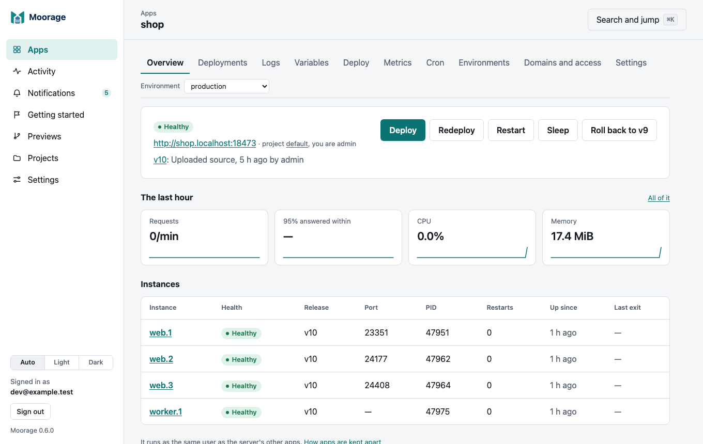
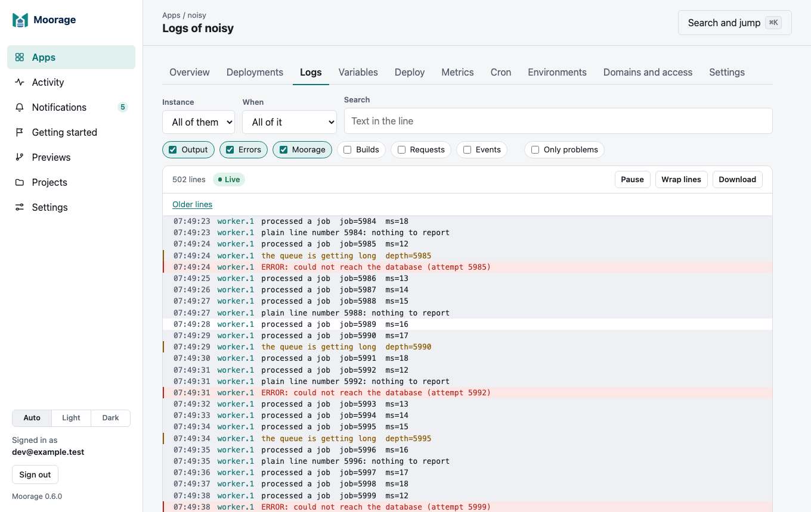

<p align="center">
  <picture>
    <source media="(prefers-color-scheme: dark)" srcset="docs/assets/moorage-logo-dark.svg">
    
  </picture>
</p>

<p align="center"><strong>Deploy apps to your own server. Get a URL. Watch them run.</strong></p>

Moorage is a self-hosted platform for deploying web apps. It is one program,
`moor`: install it on a server or your laptop, and deploy an app from its
source directory with `moor deploy`. Moorage works out how to build it,
installs the toolchains it needs, runs it under supervision, and serves it on
a hostname of its own, with zero-downtime releases and instant rollbacks.

No containers, agents, databases or proxies to set up: the server is a single
binary with its state in SQLite, and everything else is built in.

## What it does

- **Deploys with `git push`,** over SSH or HTTPS, to a repository on the
  server: the push shows the build as it happens, and fails if the deploy
  does. Or upload a directory with `moor deploy`.
- **Builds from source.** Go (from `go.mod`), Python (with uv, from
  `pyproject.toml` and `uv.lock`), Node.js (with npm), static sites, or the
  build command you give it. A `moorage.toml` is optional.
- **Installs toolchains on demand.** Go, Node.js, uv and Python are
  downloaded once, checked against their published checksums, and kept per
  version, so every app gets the version it asks for.
- **Serves every app on its own hostname,** `<app>.apps.example.com`, over
  TLS with certificates from Moorage's own CA or yours, or behind a TLS proxy
  such as nginx. Static sites are served directly, with clean URLs, headers
  and redirects.
- **Releases without downtime.** A new release takes traffic only once it
  answers its health checks, and the old one finishes its requests first.
  `moor rollback` brings the previous release back in a second.
- **Runs containers when you want them.** An app with a `Containerfile`, or an
  image from a registry, runs under Podman or Docker, released and rolled back
  like any other. Nothing else needs an engine.
- **Keeps apps running.** Each instance runs under a small supervisor that
  restarts it when it fails and keeps it running while the server itself
  restarts or is upgraded.
- **Configures apps with variables and secrets.** Secrets are encrypted on
  the server and handed to apps in memory only; every change is a new
  release.
- **Runs what an app needs on a schedule.** Cron jobs in its manifest, and `moor run` for
  a command now, with its variables and data, like `moor run -- python manage.py migrate`.
- **Shows how it is doing, and says when it is not.** Requests, response times, CPU and memory
  for each environment, kept for a year and ready for Prometheus. A failed deployment, a crash
  loop or a failed cron job reaches those concerned in the console, and by webhook, Slack, Teams,
  Discord or email: one message and not hundreds, then a word when it recovers.
- **A web console.** Deploy, scale, restart and roll back from the browser; watch a
  deployment's stages and log as they happen; follow and search logs; change
  variables. Drop a folder on it and that is a static site. It works on a phone, and without
  scripts.
- **Accounts for a team.** Sign in from any machine by approving it in a
  browser; scoped API tokens for CI; SSH keys for pushing; each deploy records
  who did it. On your own computer you need none of this.

## The console

Every server has one, at its own address. An app, with its instances, and what you can do
to it:

<p align="center">
  <picture>
    <source media="(prefers-color-scheme: dark)" srcset="docs/assets/console-app-dark.png">
    
  </picture>
</p>

Its logs, live, with what matters standing out:

<p align="center">
  <picture>
    <source media="(prefers-color-scheme: dark)" srcset="docs/assets/console-logs-dark.png">
    
  </picture>
</p>

[The console's guide](docs/console.md) has the rest.

## Quick start

Try it on your own computer. On macOS or Linux:

```bash
curl --proto '=https' --tlsv1.2 -fsSL https://raw.githubusercontent.com/robert-mcdermott/moorage/main/install.sh | sh
```

In PowerShell on Windows 11:

```powershell
irm https://raw.githubusercontent.com/robert-mcdermott/moorage/main/install.ps1 | iex
```

That picks the file for your computer from the
[latest release](https://github.com/robert-mcdermott/moorage/releases/latest), checks
its checksum and needs no administrator rights. The
[installation guide](docs/install.md) has the details, and how to read the script
first.

Start a server for this computer only (apps at `http://<app>.localhost:8080`):

```bash
moor server init --preset local
```

```bash
moor server run
```

In another terminal, deploy one of the [examples](examples/README.md), a
FastAPI app with a web page:

```bash
git clone https://github.com/robert-mcdermott/moorage && cd moorage/examples/python-fastapi
```

```bash
moor deploy
```

```text
moorage  tasks · production · dep_01M6HDSDWTJVY7C5J56WNCCYCR
▸ detected   python · uv latest (the python runtime) · python 3.13 (.python-version)
▸ toolchains uv 0.13.7, python 3.13.18
▸ install    uv sync --no-dev --locked
▸ built      883 files, 15.1 MiB in 1m57.4s
▸ release    v1: python -m tasks.migrate
▸ rollout    web ×1
✔ live       v1  http://tasks.localhost:8080  (1m58.2s)
```

Open <http://tasks.localhost:8080>. Then change it, look at it, and undo:

```bash
moor env set TASKS_TITLE="Team tasks"    # a new release, without downtime
```

```bash
moor logs -f
```

```bash
moor rollback --with-config
```

To deploy your own app with git, register your SSH key once, then, in the
app's repository, add its remote and push
([deploying with git push](docs/git.md)):

```bash
moor keys add
```

```bash
moor git remote
```

```bash
git push moorage main
```

## On a server

```bash
sudo moor server init --domain apps.example.com
```

```bash
sudo moor server install    # a systemd unit on Linux, a launchd daemon on macOS
```

Point a wildcard DNS record, `*.apps.example.com`, at the server, and apps
are at `https://<app>.apps.example.com`. Open the setup link that `init` printed
to create the first account, then sign in from your own machine:

```bash
moor login https://moorage.apps.example.com
```

`moor trust` makes browsers on your computer accept the server's certificates, and
`moor server doctor` checks the setup and says how to fix what it finds.
[Installing Moorage](docs/install.md) covers the rest, [TLS and trusting the
server](docs/tls.md) certificates, [Behind a TLS proxy](docs/proxy.md) nginx, and
[Accounts and access](docs/accounts.md) users, tokens and keys.

## Examples

| Example | What it shows |
|---|---|
| [Tasks](examples/python-fastapi): FastAPI, uvicorn and a web page | uv, SQLite in the app's data directory, migrations as the release command |
| [Links](examples/go-stdlib): Go with only the standard library | A build from `go.mod` alone, a graceful stop, data two instances share |
| [Poll](examples/node-express): Express and a Vite front end | The npm build, assets cached for good, variables from `[env]` |
| [Handbook](examples/static-site): a static site | Clean URLs, a 404 page, headers and redirects |
| [Guestbook](examples/container-go): a Go app in a container | A multi-stage Containerfile, an image with one binary, resource limits |

## Documentation

- [Documentation](docs/README.md): installing Moorage, deploying each kind
  of app, variables and secrets, accounts, the [`moorage.toml`
  reference](docs/manifest.md), [containers](docs/containers.md), [the
  API](docs/api.md) and [what to do when something is wrong](docs/troubleshooting.md).
- [Design](spec/README.md): how Moorage works inside, the
  [roadmap](spec/11-roadmap.md) and the [decisions](spec/12-decisions.md)
  behind it.
- [Changelog](CHANGELOG.md).

## Status

Moorage 0.6.0 is a server on Linux or macOS for a team: it builds and deploys
apps from their source or a `git push`, in containers or not, with accounts, projects
and roles, an audit log and a [web console](docs/console.md). Every branch can have
[its own preview and address](docs/previews.md), which sleeps when idle, and [who can
reach it](docs/access.md) is up to you: a password, a sign-in, a share link. Apps can have
[domains of their own](docs/domains.md), [cron jobs and one-off commands](docs/cron.md),
[metrics](docs/metrics.md) and [notifications](docs/notifications.md) when something goes
wrong. On Linux, [each app runs as a user of its own](docs/isolation.md). [Backups](docs/backups.md)
are built in, people can sign in with [a second factor, or through your identity provider](docs/sign-in.md),
and a server [upgrades itself](docs/install.md#upgrading), with a way back. On Windows, `moor` works as a
command line and `moor server run` works; the Windows service comes later.

Next, in the [roadmap](spec/11-roadmap.md):

- **0.7.0, Windows, forges and the terminal:** the Windows service, deployments from a forge's
  webhooks, and a terminal in the console.

## Building Moorage

Moorage needs Go 1.26 or newer and nothing else: every build is pure Go
(`CGO_ENABLED=0`), for Linux, macOS and Windows on amd64 and arm64.

```bash
go build ./cmd/moor
```

```bash
go test ./...
```

The sample apps of [testdata/apps](testdata/apps) are built from source
with real toolchains (downloaded on the first run), and the examples are
deployed with the binary, by:

```bash
MOORAGE_TEST_BUILDS=1 go test ./internal/server -run TestSampleApps -v
```

```bash
.github/scripts/examples-check.sh
```

To run a development server beside an installed one, give it a
configuration and a data directory of its own:

```bash
./moor server init --preset local --config ~/moorage-dev/server.toml --data-dir ~/moorage-dev/data
```

```bash
MOORAGE_CONFIG=~/moorage-dev/server.toml ./moor server run
```

Work is planned in waves and slices: each wave has a `waveN` branch and ends
in a release (see the [roadmap](spec/11-roadmap.md)). Changes are recorded in
the [changelog](CHANGELOG.md).

## License

Moorage is licensed under the [Apache License 2.0](LICENSE).
