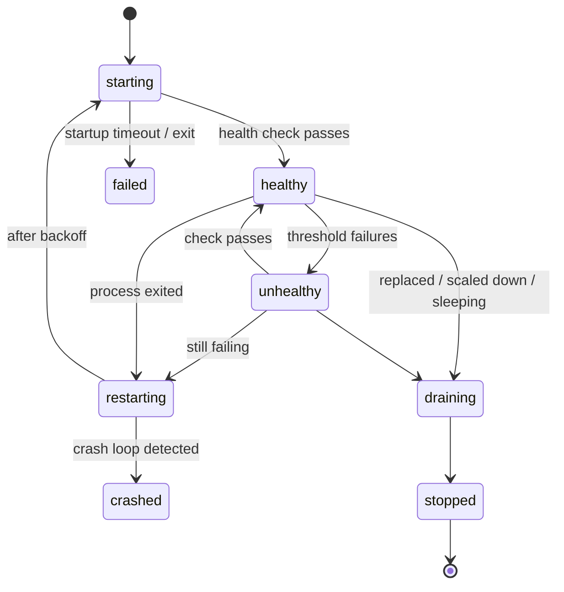

# 5. Runtime: Running and Supervising Apps

## Drivers

| Driver | Used for | How it runs an instance |
|---|---|---|
| `native` | `static` (no process), `go`, `python`, `node`, `bun`, `deno`, `binary`, `command` | A supervised OS process started through `moor shim` |
| `container` | `dockerfile`, `image` | A labelled container started through the Podman or Docker CLI |

Planned (Phase 4): **native-in-container isolation** — run a *native* build
inside a minimal base image with the build directory mounted read-only. This
gives container-grade isolation to apps that have no Containerfile, on hosts
where an engine is available.

## Instance lifecycle

The **environment status** shown in the console is rolled up from its
instances: `deploying`, `healthy`, `degraded` (some instances unhealthy),
`unhealthy` (none healthy), `crashed`, `sleeping`, `stopped`.

## Command execution

- Commands from the manifest are parsed by Moorage's **embedded POSIX-
  compatible shell** (`mvdan.cc/sh`), so shell *syntax* behaves the same on
  Linux, macOS and Windows: variable expansion, quoting, `&&`, `||`, pipes,
  redirection, `$(…)` and `cd` all work without a system shell. The programs
  a command calls must exist on the host — there are no built-in Unix
  utilities, and stock Windows has no `cp`, `grep` or `sed`. A few shell
  features are unavailable (job control, `ulimit`, and process substitution
  on Windows).
- If the command is a *simple command* (no pipes, lists or redirections), the
  program is executed **directly**, so the app process receives signals
  itself.
- Otherwise the embedded shell runs inside the instance's own process tree —
  in a helper process started with the instance's user, limits and sandbox —
  never inside the shim, so every part of a pipeline is confined the same way.
- `shell = "system"` (server or app setting) uses `/bin/sh -c` on Unix and
  `cmd.exe /c` on Windows instead.
- Working directory: the build directory (native) or the image `WORKDIR`.
- `stdin` is `/dev/null`. Output is captured by the shim (native) or engine
  (container).

## Environment variables

Instances do **not** inherit the daemon's environment. The environment is
assembled in layers, later layers winning:

1. A minimal base: `PATH` (toolchains, project tool directories, then a
   standard system path), `HOME` (the data directory), `LANG=C.UTF-8`, `TZ`,
   `TMPDIR` (a per-instance temporary directory).
2. The runtime's own variables: `PYTHONUNBUFFERED=1` and `VIRTUAL_ENV`
   (the build's `.venv`) for Python, `NODE_ENV=production` for Node.js.
3. The manifest's `[env]`.
4. The manifest's `[environments.<env>].env` (or `[environments.preview]`).
5. Server-side app variables (all environments).
6. Server-side environment-scoped variables.
7. Variables injected by Moorage (cannot be overridden):

| Variable | Example | Notes |
|---|---|---|
| `PORT` | `24817` | Where an exposed process must listen. In containers: the container port. |
| `HOST` | `127.0.0.1` | `0.0.0.0` inside containers. |
| `MOORAGE_APP` / `MOORAGE_ENV` | `acme-portal` / `production` | |
| `MOORAGE_ENV_KIND` | `production` \| `named` \| `preview` | |
| `MOORAGE_RELEASE` | `v8` | |
| `MOORAGE_BUILD_ID`, `MOORAGE_COMMIT`, `MOORAGE_BRANCH` | | |
| `MOORAGE_URL` | `https://acme-portal.apps.example.com` | Primary public URL. |
| `MOORAGE_BASE_PATH` | `""` or `/acme-portal` | Non-empty when served under a path prefix. |
| `MOORAGE_PROCESS`, `MOORAGE_INSTANCE`, `MOORAGE_INSTANCE_ID` | `web`, `1`, `ins_…` | |
| `MOORAGE_DATA_DIR` | `/var/lib/moorage/data/acme-portal/production` | Persistent; mounted path in containers. |
| `MOORAGE_BIN` | `<build>/.moorage/bin` | Where runtime presets put built binaries. |

Secret values are decrypted only at instance start and passed to the process
directly (native) or through a temporary `0600` env-file that is removed after
start (containers) — never on a command line where `ps` could show them.

## Ports

- Each exposed instance gets a port from a configurable range (default
  `20000–29999`) on the loopback interface. The allocator picks randomly,
  skips ports reserved in the database, test-binds to confirm the port is
  free, then records the reservation against the instance.
- An instance keeps its port across in-place restarts; a rollout always uses
  new instances and therefore new ports, which is what makes the switch
  atomic.
- Containers are published as `-p 127.0.0.1:<host-port>:<container-port>`.
- **Exposure check:** apps are asked to bind `127.0.0.1` (`HOST`). Native apps
  could still bind a public interface, so the observability sampler
  periodically checks listening sockets owned by app processes and flags any
  non-loopback listener in the console. In `sandbox` isolation on recent Linux
  kernels, Landlock network rules can additionally restrict an instance to
  binding only its assigned port.

## Health checks

| Check | When | Default |
|---|---|---|
| **TCP** | Exposed processes without `health.path` | Connect to `127.0.0.1:$PORT` |
| **HTTP** | `health.path` set | `GET` with the app's primary `Host` header; 2xx/3xx healthy |
| **Command** | `health.command` set | Exit status 0 healthy |
| **Process alive** | Non-exposed processes (workers) | Running and not restarting |

- **Readiness** is enforced during rollouts (`health.startup`), **liveness**
  continuously afterwards (`health.interval`).
- After `threshold` consecutive failures an instance is marked `unhealthy` and
  removed from load balancing; if it keeps failing for another `threshold`
  checks it is restarted.
- Health checks are run by the daemon, not the container engine, so behaviour
  is identical for both drivers.

## Restarts and crash loops

- Native instances are restarted by their **shim** (so this works even while
  the daemon is restarting); containers are restarted by the reconciler.
- Backoff: 1 s, 2 s, 4 s … capped at 60 s; reset after 10 minutes of healthy
  uptime.
- **Crash loop:** 5 restarts within 10 minutes → instance status `crashed`,
  backoff raised to 5 minutes, notification sent, last output lines attached
  to the event.
- **Exit reasons** are decoded for humans: out-of-memory kill (Linux cgroup
  `memory.events`, container OOM flag), signal names, exit codes, and
  soft-limit restarts.

## Stopping and draining

1. The instance is removed from the routing table (no new requests).
2. Moorage waits until the instance's in-flight request count reaches zero, up
   to `deploy.drain`. Long-lived connections (WebSocket, SSE) are closed at the
   end of the drain period.
3. `stop_signal` is sent; after `stop_timeout` the entire process tree is
   killed (Linux: `cgroup.kill` or process group; macOS: process group;
   Windows: `CTRL_BREAK_EVENT` to the process group, then Job Object
   termination; containers: engine stop with timeout).

## Scaling and load balancing

- `moor scale web=3 worker=2` sets the formation; the setting is stored
  server-side and overrides the manifest's `instances`.
- Requests are balanced across healthy instances with **power-of-two-choices
  on in-flight requests**: cheap, and naturally avoids a slow instance.
- Connection failures to an instance are retried once on another instance for
  idempotent requests, and feed passive health (the instance is temporarily
  ejected).
- Sticky sessions (cookie-based) are an optional per-app setting (Phase 3).

## Resource limits

Limits come from the manifest `[resources]`, overridden by server-side app or
environment settings, with server-wide defaults per environment kind (for
example: previews 512 MiB / 0.5 CPU).

| Platform | Mechanism | Memory | CPU | PIDs |
|---|---|---|---|---|
| Linux (native) | cgroup v2 subtree delegated to the service (see [Architecture → Linux](02-architecture.md#linux-service-unit-and-cgroup-layout)): one cgroup per instance and per build, processes placed directly into it at spawn | `memory.max` (+ `memory.high` at 90 %), OOM kills the whole instance tree | `cpu.max` | `pids.max` |
| macOS (native) | `setrlimit` + **soft enforcement** (sampled RSS above the limit → graceful restart with an explicit event) | soft | — | `RLIMIT_NPROC` |
| Windows (native) | Job Object per instance | commit limit — allocations beyond it fail (the app is not killed), plus soft enforcement | CPU-rate hard cap | active-process limit |
| Containers | Engine flags | `--memory` | `--cpus` | `--pids-limit` |

Soft enforcement is also used on Linux when cgroup delegation is unavailable,
so a limit always means *something*, and the console says which mechanism is
active.

## Isolation levels

Moorage assumes deployers are trusted teammates (see
[Security](08-security.md)). Isolation exists to prevent accidents and limit
blast radius, and the console states the level of every environment.

| Level | What it adds | Platforms |
|---|---|---|
| `none` | Instances run as the service user, in their own process group / Job Object. | All |
| `user` *(Linux default when the daemon runs as root)* | Each app gets its own UID/GID from a reserved range (no `/etc/passwd` entries needed). Build directories are read-only to the app; its data directory is owned by the app's UID. Apps cannot read each other's data or secrets on disk. | Linux |
| `sandbox` | `user` + cgroup limits + Landlock filesystem rules (read-only: build dir, toolchains, system libraries; read-write: data dir, temp dir) + `no_new_privs`; on kernels with Landlock network support, bind restricted to the assigned port. | Linux ≥ 5.13 |
| `container` *(planned)* | Native build run inside a minimal container. | Where an engine is available |

On Linux the controls are applied *in the child* between fork and exec by a
tiny exec helper: the shim re-executes `moor` in a helper mode as the app's
process, already inside the instance cgroup and under the app's UID/GID; the
helper applies Landlock and `no_new_privs`, then replaces itself with the app
via `exec`. The shim itself stays unrestricted, so it can keep writing logs
and taking commands from the server. Everything is plain system calls — no external
tools. Landlock runs in best-effort mode (it is a no-op on kernels without
it), so the console reports the protection that is actually in effect.

## Persistent data

- Each environment has `data/<app>/<env>/`, exposed as `$MOORAGE_DATA_DIR`
  (native) or mounted at `[storage].mount` (containers, with SELinux
  relabelling where needed).
- Data survives deploys, restarts and rollbacks. Deleting an environment moves
  its data to a trash area for 7 days.
- Backups include data directories (Phase 3).

## Sleep and wake (scale to zero)

- The ingress records the last request time for each environment. When an
  environment has been idle longer than its `sleep_after` and has no open
  long-lived connections, the scheduler sets its formation to zero and the
  status to `sleeping`. Processes can opt out (`sleep = false` on a process).
- Defaults: previews sleep after 30 minutes idle; production and named
  environments never sleep unless configured.
- **Wake:** the next request triggers a wake. Moorage holds the request for up
  to two seconds; if the app is not ready by then, browsers get a small
  "waking up" page that reloads itself as soon as the environment is healthy,
  and API clients keep waiting up to `wake_timeout` (default 30 s) before a
  `503` with `Retry-After`.
- Static apps never sleep — they have no processes.

## Cron jobs and one-off runs

- Cron jobs run as **one-off instances** of the environment's current release,
  with the same environment variables and data directory, and no port unless
  requested. Output goes to a per-run log; the last 100 runs per job are kept
  with status, duration and exit code.
- `moor cron list`, `moor cron run <name>` (manual trigger), and a cron tab in
  the console showing next and previous runs.
- `moor run -- <command>` starts a one-off instance and streams its output,
  returning its exit code (Phase 2). Interactive sessions over a PTY through
  the API's WebSocket (`moor run -it -- bash`, and a web terminal in the
  console) arrive in Phase 3. For containers, `moor exec <instance>` attaches
  to a running container.

## Container driver details

- **Engine selection:** `auto` (Podman if present, else Docker), or an
  explicit binary path. Remote engines configured through the engine's own
  environment (`CONTAINER_HOST` / `DOCKER_HOST`) are honoured.
- **Rootless vs rootful:** the engine runs as the daemon's user. A daemon
  running as root uses a rootful engine; laptop mode and single-user servers
  use rootless Podman, whose default user-mode networking publishes loopback
  ports without extra setup (privileged ports are never needed because the
  ingress owns 80/443). Running the engine as a separate unprivileged user is
  a Phase 3 option.
- **One lifecycle, two observers:** the two CLIs accept the same lifecycle
  commands and flags (`build`, `pull`, `run`, `stop`, `rm`, `inspect`), but
  their machine-readable outputs for `ps`, `stats` and `events` differ in shape
  and report human-formatted numbers. Lifecycle therefore goes through one
  code path, and observation through a small adapter per engine (below).
- **Naming and labels:** `moorage-<app>-<env>-<process>-<n>-<short-id>`, with
  labels `io.moorage.managed=true`, `io.moorage.app`, `io.moorage.env`,
  `io.moorage.release`, `io.moorage.process`, `io.moorage.instance`. Anything
  labelled as managed but unknown to the database is removed by the reconciler.
- **Run flags:** detached, `--init`, `--restart=no` (Moorage owns restarts),
  `-p 127.0.0.1:…`, `--env-file` (temporary, `0600`), data volume, resource
  flags, `--stop-signal`, `--stop-timeout`, log size caps, and
  `--security-opt no-new-privileges`.
- **Observability:** on Linux, container CPU and memory are read straight
  from each container's cgroup — the same code that measures native instances.
  Exits and OOM kills come from the engine's event stream, filtered by Moorage
  labels and parsed by the engine adapter. When the engine's API socket is
  available (Docker; Podman with its API service enabled; the VM-based engines
  on macOS and Windows), the Docker-compatible REST API is used for events and
  stats instead of the CLI. Logs use `logs --follow --since` per instance,
  resumed from the last seen timestamp after a daemon restart.
- **Images:** builds are tagged `localhost/moorage/<app>:<build-id>`. For the
  `image` runtime, the tag is resolved to a **digest** when the release is
  created, so rollbacks and restarts run exactly the same image. Registry
  credentials are stored as secrets and passed through a temporary auth file.

## Platform notes

**Windows.** Native apps run under the service account (or a configured
account). Each shim owns a windowless console and creates its app in a new
process group on that console, **directly inside a Job Object** (using the
job-list process-creation attribute, so no child process can start before the
job applies). Graceful stop sends
`CTRL_BREAK_EVENT` to the app's process group (possible precisely because the
shim shares the app's console, which a console-less service could not do
directly); after the stop timeout the Job Object is terminated. The job's
kill-on-close ties the app's lifetime to its shim, not to the daemon. Python
virtual environments use `Scripts\` instead of `bin/`; runtime presets handle
the differences, and the embedded shell keeps manifest commands portable.
Long paths are enabled for the data directory.

**macOS.** Laptop mode typically runs as a per-user launchd agent in the
logged-in user's account, which is also what rootless Podman machines expect.
The launchd job is told not to reap leftover processes
(`AbandonProcessGroup`), and shims start their own sessions, so apps survive
daemon restarts. A non-root process may bind ports 80/443 on macOS only on the
wildcard address — which also listens on the local network — so laptop mode
defaults to `:8080` on loopback; choosing `:80` gives port-free URLs at the
cost of LAN exposure (gates still apply). See
[Architecture → Configuration](02-architecture.md#configuration) for how
`*.localhost` names resolve.
