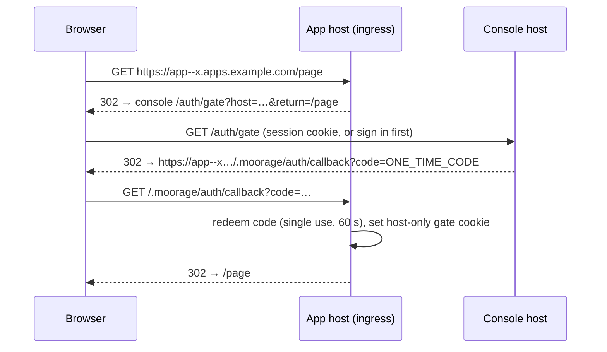

# 6. Ingress, Routing and TLS

Moorage owns the front door. Because the ingress router is built in, every
environment gets a working URL, a certificate and an access policy the moment
it is created — and the router knows exactly which instances are healthy,
which are draining and which environments are asleep.

## Listeners

| Listener | Default | Purpose |
|---|---|---|
| HTTP | `:80` | ACME HTTP-01 challenges; redirect to HTTPS when TLS is on; plain serving when TLS is off |
| HTTPS | `:443` | HTTP/1.1 and HTTP/2, TLS 1.2+ |
| SSH | `:2222` | Git pushes (see [Build and Deploy](04-build-and-deploy.md#git-server)) |

Laptop mode defaults to `:8080`. On Linux, if the daemon does not run as root,
the systemd unit grants `CAP_NET_BIND_SERVICE` for ports below 1024.

Moorage can terminate TLS itself or listen on plain HTTP behind an existing
TLS-terminating proxy such as nginx — both are first-class; see
[Deployment topologies](#deployment-topologies).

## Hostnames

With base domain `apps.example.com` and a wildcard DNS record
`*.apps.example.com → <server IP>`:

| What | Hostname |
|---|---|
| Console, API, HTTPS git | `moorage.apps.example.com` (configurable; may be outside the base domain) |
| Production | `<app>.apps.example.com` |
| Named environment | `<app>--<env>.apps.example.com` |
| Preview | `<app>--<branch-slug>.apps.example.com` |
| Custom domain | Any hostname attached to an environment, e.g. `portal.acme-demo.com` |

- Every generated hostname is a **single DNS label** under the base domain, so
  one wildcard record and one wildcard certificate cover everything.
- **App names:** `^[a-z][a-z0-9-]{1,38}[a-z0-9]$`, no `--`. Reserved: `moorage`,
  `console`, `api`, `git`, `www`, `admin`, `status`, `assets`, `login`,
  `auth`. When `<app>--<env>` would exceed 63 characters, the environment part
  is truncated and suffixed with a short hash.
- **Custom domains** (`moor domains add portal.acme-demo.com --env production`)
  are verified by DNS (a CNAME to the environment's generated hostname, or an
  A/AAAA record to the server) before a certificate is requested. The console
  shows the exact record to create and live verification status.

## Path-based routing

Any route may include a path prefix, so several apps can share one hostname:
`https://tools.example.com/reports/`, `https://tools.example.com/admin/`.

**Path mode** is for installations without wildcard DNS
(`moor server init --routing path`): apps live at `https://<host>/<app>/`,
previews at `https://<host>/<app>--<env>/`, and the console at `/`.

Serving an app under a prefix needs the app's cooperation, because the app
generates links. Moorage helps as much as it safely can:

- By default the prefix is **kept** when proxying and announced to the app via
  `X-Forwarded-Prefix` and `MOORAGE_BASE_PATH` (most frameworks have a
  "root path"/"base" setting to read it). `strip_prefix = true` removes it
  instead.
- `Location` headers that point at an absolute path without the prefix are
  rewritten to include it, and `Set-Cookie` paths are scoped to the prefix.
- Response bodies are **never rewritten** — that approach is fragile and is
  deliberately not offered.
- Static sites are fully supported under a prefix as long as they use
  relative links or the configured base.

Hostname routing is recommended whenever a wildcard DNS record is possible.

## Reserved path

Every hostname served by Moorage reserves the prefix **`/.moorage/`** for
platform endpoints: the sign-in gate callback, share-link redemption, wake
status polling and platform page assets. Requests under it never reach apps.

## Routing table

- The reconciler builds the routing table from environments, domains, healthy
  instances, static build roots and gates.
- Lookup: exact hostname → longest matching path prefix → within the
  environment, the manifest's routes (process or static) by longest prefix.
- Unknown hostnames under the base domain get a "no such app" page (with a
  "create it" shortcut for signed-in users); unknown hostnames elsewhere get a
  plain 404 and **no certificate**.
- The table is an immutable snapshot swapped atomically; each request reads one
  snapshot without locks. A generation counter makes route changes observable
  in the console and in tests.

## Proxy behaviour

- One shared, tuned transport (keep-alive pools per backend, 2 s dial timeout,
  configurable response-header timeout, no overall timeout so streams work).
- **Headers added:** `X-Forwarded-For`, `X-Forwarded-Proto`, `X-Forwarded-Host`,
  `X-Forwarded-Prefix`, `Forwarded`, `X-Real-IP`, and `X-Request-Id`
  (generated if absent, echoed on the response, recorded in logs).
- **Headers removed:** hop-by-hop headers, any incoming `X-Moorage-*` header,
  and Moorage's own cookies — so a client can never spoof platform identity.
- **No indexing outside production:** responses from previews and named
  environments carry `X-Robots-Tag: noindex` (configurable, and available for
  production on purely internal installations).
- **Identity headers:** behind a *sign-in* gate, the app receives
  `X-Moorage-User`, `X-Moorage-User-Email`, `X-Moorage-User-Name` and
  `X-Moorage-Groups`. Apps can trust these because they listen on loopback.
- **Protocols:** WebSockets and other upgrades (browsers open these over
  HTTP/1.1, and Moorage always proxies upgrades to backends over HTTP/1.1 —
  even to `h2c` processes); server-sent events and streaming responses are
  flushed immediately; response trailers pass through; HTTP/2 to clients; HTTP/1.1 to
  backends by default, with opt-in cleartext HTTP/2 to a process for gRPC
  (`protocol = "h2c"`, Phase 3).
- **Limits:** request body size (default 100 MiB, per-app override), header
  size, header read timeout (slow-client protection).
- **Errors:** connection failures are retried once on another healthy instance
  for idempotent requests; otherwise a branded 502/503 page (below).

## TLS

TLS mode is set server-wide, with per-domain overrides. Moorage is
**internal-first** and flexible: it can terminate TLS with an automatically
generated CA or with certificate files you provide, or it can run plain HTTP
behind your own TLS proxy. ACME arrives with internet-facing support.

| Mode | Description |
|---|---|
| `internal` *(default)* | Moorage acts as a certificate authority and issues short-lived certificates (30 days, renewed automatically) on the fly for every hostname it serves. By default it generates its own **self-signed root** on first start, which users trust once with `moor trust` (installs it into the OS trust store) or by downloading it from `/.moorage/ca.crt`. Alternatively it signs with an **intermediate CA issued by your corporate CA** — ideally name-constrained to the base domain — so company machines trust its certificates with no extra steps. |
| `files` | Certificate and key files on the filesystem — typically a corporate wildcard for `*.<base-domain>`. Several pairs can be listed (chosen by SNI); files are watched and hot-reloaded. |
| `off` | Plain HTTP — behind a TLS-terminating proxy (see [Deployment topologies](#deployment-topologies)), or laptop mode. |
| `acme` *(Phase 3)* | Automatic certificates from an ACME directory — an internal ACME server or a public CA. Per-host certificates use HTTP-01 or TLS-ALPN-01; a **wildcard** for the base domain uses DNS-01 with a configured DNS provider (DNS-01 also suits internal servers on a public domain, because the CA never needs to reach the server). |

- Certificates are only ever issued for hostnames present in the routing table
  (an allow-list decision on every on-demand issuance), so random SNI names
  cannot trigger issuance.
- **Rate limits (ACME):** public CAs limit certificates per registered domain per
  week. Preview-heavy installations should use a wildcard certificate (DNS-01,
  `files` or `internal`); `moor server doctor` warns when per-host issuance is
  likely to hit limits.
- CA material, issued certificates and (later) the ACME account live in
  `<data>/certs`. Renewal is handled by the scheduler; expiry problems raise
  notifications.
- HTTP→HTTPS redirects are on whenever Moorage terminates TLS (behind a proxy,
  the proxy does this). HSTS is off by default (internal domains are often
  shared with other services) and can be enabled.

## Access gates

Each environment has one access gate. Defaults come from server-wide settings
per environment kind (e.g. *previews require sign-in*), can be suggested by
the manifest, and can be overridden by maintainers.

| Gate | Behaviour |
|---|---|
| `public` | Anyone can access. |
| `password` | A shared password. Browsers get a small branded form; non-browser clients may use HTTP Basic. Remembered by cookie for a configurable period. |
| `login` | Visitor must be signed in to Moorage — any user, or only members of the app's project/groups. Identity is passed to the app in headers. API tokens with the `gate` scope are accepted as bearer tokens for scripted access. |
| `share` | Only reachable through share links. |
| IP allow-list | CIDR list, combinable with any gate above. |

**Share links** work with every gate: `moor share --expires 7d [--max-uses 20]`
produces `https://<host>/.moorage/share/<token>`. Tokens are 128-bit random
values stored hashed, expire, can be revoked, and record who created them.
Redeeming one sets a host-only cookie and redirects to the clean URL.

### Sign-in gate flow



### Cookie rules (important)

- The **console session cookie** is host-only on the console hostname
  (`__Host-` prefix, `Secure`, `HttpOnly`, `SameSite=Lax`). It is never scoped
  to the parent domain; otherwise every app on a sibling subdomain would
  receive it.
- **Gate cookies** are host-only per app hostname, HMAC-signed with an expiry,
  and stripped from requests before they are proxied to the app.
- Apps on sibling subdomains are *same-site* with the console, so the API
  requires CSRF tokens for cookie-authenticated mutations and checks
  `Origin` / `Sec-Fetch-Site` (see [Security](08-security.md)).

## Platform pages

Small, branded pages (light and dark) served by the ingress:

| Page | When |
|---|---|
| No such app | Unknown hostname/path under the base domain |
| Deploying | First deploy of an environment still in progress (signed-in users see live progress) |
| Waking up | Sleeping environment starting; reloads itself when ready |
| Unavailable | No healthy instance (`502/503`). Signed-in users see the status, last log lines and a console link; anonymous visitors see a generic message |
| Maintenance | `moor maintenance on --message "…"` |
| Gate pages | Password form, expired/invalid share link, access denied |

## Static file serving

Static builds are served directly by the ingress — no process, no port, no
memory per site.

- `[static]` rules are compiled when the build is packaged into an index of
  files, compressed variants and content hashes (for strong ETags), so serving
  needs no directory scans.
- Conditional and range requests, a built-in MIME table (identical on every
  OS), pre-compressed `.br`/`.gz` variants, SPA fallback, clean URLs, header
  and redirect rules.
- Optional directory listings (`[static] listing = true`) for internal file
  shares and artifact sites.
- Deploys and rollbacks switch the document root atomically.
- **Release permalinks** *(Phase 2)*: because old static builds cost nothing
  to serve, every retained static release is also reachable at its own
  immutable URL (`<app>--<env>--v12.<base-domain>`, same gate), which is handy
  for comparing versions or linking a reviewer to an exact build.

## Metrics and access logs

- Per environment and per route: request rate by status class, latency
  histogram, bytes in/out, in-flight requests, upstream errors, wake events.
  These feed the console graphs (see [Observability](07-observability.md)).
- Access log per environment as structured lines: time, request ID, method,
  host, path, status, duration, bytes, upstream instance, gate user, client IP.
  Shown in the console as the **router** log source.

## Deployment topologies

Moorage is equally at home terminating TLS itself or sitting behind an
existing TLS-terminating reverse proxy. Choose per installation:

| Topology | `[tls] mode` | When to use |
|---|---|---|
| **Moorage terminates TLS** | `internal` or `files` (`acme` in Phase 3) | Simplest — nothing else to run. |
| **Behind a TLS proxy** (e.g. nginx) | `off` | You already run a reverse proxy or load balancer, want its certificates, access logs or WAF, or policy requires one. |
| **TLS passthrough** | `internal` or `files` | A proxy or load balancer forwards raw TLS by SNI; Moorage still terminates. |
| **Plain HTTP end to end** | `off` | Laptop mode on `localhost` only. |

Routing, gates, wake-on-request, static serving and metrics behave the same
in every topology.

### Behind a TLS proxy

```toml
# server.toml
[listen]
http = "127.0.0.1:8080"              # or a private address the proxy can reach
ssh  = ":2222"                       # git over SSH goes straight to Moorage (or via a TCP proxy)

[tls]
mode = "off"                         # the proxy terminates TLS

[proxy]
trusted         = ["127.0.0.1/32"]   # honour X-Forwarded-* / PROXY protocol only from these
external_scheme = "https"            # the scheme browsers see
```

- With `external_scheme = "https"`, Moorage generates `https://` URLs
  (`MOORAGE_URL`, redirects, sign-in gate callbacks), marks its cookies
  `Secure`, and leaves HTTP→HTTPS redirects to the proxy.
- Forwarded headers (`X-Forwarded-For`, `-Proto`, `-Host`, `Forwarded`) and
  the PROXY protocol are honoured **only** from `trusted` addresses; from
  anywhere else they are stripped, so clients cannot spoof their address or
  scheme.
- **What the proxy must do:**
  - send the console hostname and `*.<base-domain>` (or the path-mode host) to
    Moorage, **preserving the `Host` header**;
  - pass WebSocket upgrades (HTTP/1.1 with `Upgrade`/`Connection` headers);
  - not buffer streaming responses (logs, events, deploy progress) — Moorage
    marks them with `X-Accel-Buffering: no`, which nginx honours;
  - allow long-lived requests: an HTTPS `git push` stays open for the whole
    deployment, so a one-minute read timeout breaks pushes;
  - accept large request bodies for HTTPS pushes and uploads (nginx's default
    limit is 1 MB).
- `moor server proxy-config nginx` prints a ready-to-use nginx configuration
  for the configured domains with all of the above; the console's System page
  lists the same requirements for other proxies.
- `moor server doctor --public-url https://moorage.apps.example.com` checks
  the whole path: forwarded headers arriving from a trusted address, WebSocket
  upgrades, unbuffered streaming and timeouts.
- `/.moorage/health` answers on every hostname for proxy and load-balancer
  health checks.
