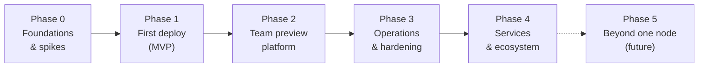

# 11. Roadmap

The roadmap is organised in phases. Each phase ends in something a team can
use, has explicit exit criteria, and leaves the documentation, API contract
and upgrade path in a releasable state.

## Phase 0 — Foundations and spikes

**Goal:** a skeleton that builds everywhere, and evidence that the risky parts
work before they are built properly.

- Repository layout, `moor` command tree, version info, embedded console
  skeleton (layout template, CSS design tokens, SSE helper),
  `moor server init/run`.
- CI: unit tests on Linux, macOS and Windows; cross-compilation for all six
  targets with `CGO_ENABLED=0` enforced; linting; `govulncheck`.
- Store: SQLite, migrations, typed IDs, query generation. Event bus.
  Structured logging.

**Spikes** (throwaway proofs, each ending in a short written finding and an
update to [Decisions](12-decisions.md)):

| # | Question | Done when |
|---|---|---|
| S1 | Can we receive `git push` in-process over SSH and HTTP and stream live progress back to the client? | *Largely shown by a research probe with the git CLI.* Remaining: rejecting a ref from the pre-receive step with a deployment error; end-of-pack detection for clients that keep the connection open (tested with a non-CLI git client library); per-repository ref serialisation under concurrent pushes; the beta library wrapped behind an internal interface. |
| S2 | Do shims keep apps alive across daemon restarts on all three OSes, without orphans? | `systemctl restart` (with `KillMode=process` and delegation), a launchd restart and a Windows service restart under load drop no requests; killing a shim kills its app on every OS; shim RSS measured (target ≤ 5 MB). |
| S3 | Do in-place builds work for uv/Python, Node and Go, including partial toolchain versions? | Sample apps build and run from their final directory; toolchain downloads verified. |
| S4 | Is the routing table swap really zero-downtime? | Rolling replacement under 200 req/s load with zero failed requests; WebSockets pass through. |
| S5 | Certificates: on-demand ACME with an allow-list and the internal CA mode. | Both issue and renew in a test environment (ACME test server). |
| S6 | Container driver: shared CLI lifecycle plus per-engine observation adapters. | Run, label-based adoption, exit/OOM events, cgroup-based stats on Linux and REST-based stats elsewhere, `logs --since`, rootless loopback port publishing — on current Podman and Docker releases. |
| S7 | Linux cgroup v2 delegation and Landlock applied by the shim. | Limits enforced, OOM detected and reported, filesystem rules effective. |

**Exit:** all spikes concluded; any that failed have a recorded alternative.

## Phase 1 — First deploy (MVP)

**Goal:** one team uses Moorage daily on Linux or macOS to deploy real apps
by `git push`.

- **Server:** `init` presets `lan` (default) and `local`, service install,
  basic `doctor`, first-run claim URL.
- **Identity:** users (all with full access in this phase), sessions, API
  tokens, SSH keys, CLI browser login.
- **Sources:** git push over SSH and HTTPS (production branch → `production`;
  other branches stored, not deployed), `moor deploy` (directory, static,
  artifact, image).
- **Manifest v1:** parser, validator, `explain`, JSON Schema; detection;
  runtimes `static`, `go`, `python` (uv), `node`, `command`, `binary`,
  `dockerfile`, `image`.
- **Toolchains:** Go, Node, uv + Python.
- **Runtime:** native driver with shims (restart policy, log capture),
  container driver; reconciler; rolling deploys with health checks; release
  command; rollback; restart; manual instance counts.
- **Config:** variables and encrypted secrets; every config change is a
  release.
- **Ingress:** hostname routing on a wildcard domain; TLS modes `internal`
  (auto-generated root or a corporate-issued intermediate) and `files`; plain
  HTTP behind a TLS-terminating proxy (trusted-proxy handling,
  `moor server proxy-config nginx`, end-to-end `doctor` checks); static
  serving; platform pages.
- **Observability:** log capture, rotation, follow in CLI and console;
  deployment history with persisted build logs; activity timeline.
- **Console v1:** first-run wizard, dashboard, app overview, deployments with
  live logs, logs, variables, basic server settings.
- **CLI:** `login`, `init`, `apps`, `deploy`, `git remote`, `status`, `ps`,
  `logs`, `env`, `rollback`, `restart`, `scale`, `open`.
- **Docs:** install guide, manifest reference, a quickstart per runtime.

**Exit criteria**

- A fresh VM reaches a live app in ≤ 5 minutes following the docs.
- A sample app for every runtime deploys by push and by upload in CI.
- Zero failed requests during a rolling deploy at 200 req/s.
- Restarting the daemon does not interrupt running apps.

## Phase 2 — Team preview platform

**Goal:** the "show it to someone before production" workflow is excellent.

- **Teams:** projects, roles (viewer/deployer/maintainer), audit log (API +
  CLI).
- **Environments:** branch previews (naming, inheritance, TTL, pinning,
  limits, delete on branch delete), named environments, `promote`, deploy
  locks.
- **Sleep and wake** with the waking-up page.
- **Access gates:** password, sign-in (with identity headers), share links,
  IP allow-lists; default policies per environment kind; `noindex` outside
  production.
- **Routing:** path prefixes and path mode; custom domains with DNS
  verification.
- **Processes:** workers, scaling, cron jobs, non-interactive one-off runs,
  `on_create` seeding, declared and generated variables.
- **Metrics:** collection, tiered storage, console graphs, sparklines, deploy
  markers, Prometheus endpoint.
- **Notifications:** webhook, chat webhooks, email, in-console.
- **Console:** previews page, activity feed, metrics, domains & access,
  processes, cron; drag-and-drop static deploys; static release permalinks.

**Exit criteria**

- A team of ~10 uses previews daily for a month.
- 50+ concurrent environments on a 4 vCPU / 8 GB VM with sleep enabled.
- Independent security review of the gate, cookie and CSRF design.

## Phase 3 — Operations and hardening

**Goal:** safe to run on a shared server for a whole department; Windows
supported.

- **Isolation:** per-app UIDs, cgroup limits, Landlock sandbox, soft
  enforcement elsewhere; resource limits in the console.
- **Windows server support:** Job Objects, Windows service, ConPTY; full
  integration suite passing.
- **Backups:** on demand and scheduled, local and S3-compatible; restore;
  automated restore drill in CI.
- **Forge integration:** connected repositories, deploy webhooks, pull-request
  previews with status checks and URL comments, approval for fork/unknown
  authors.
- **Interactive access:** `moor run -it`, web terminal, `moor exec`, and a
  file browser for environment data directories.
- **Telemetry export:** log forwarding, OTLP, threshold alerts.
- **Identity:** OIDC single sign-on, TOTP, trusted-header auth behind an
  authenticating proxy.
- **Internet-facing support:** ACME certificates (internal ACME servers and
  public CAs; HTTP-01, TLS-ALPN-01, and DNS-01 wildcards for a set of DNS
  providers), the `public` preset, and a hardening review for exposure beyond
  the corporate network.
- **Protocols:** cleartext HTTP/2 backends (gRPC), sticky sessions.
- **Lifecycle:** self-upgrade with rollback; server configuration
  export/import.

**Exit criteria:** external penetration test of all public surfaces; Windows
parity suite green; backup/restore drill automated.

## Phase 4 — Services and ecosystem

- **Managed services** through the container engine: PostgreSQL, MySQL,
  Redis/Valkey, S3-compatible object storage; linking with injected URLs;
  per-preview instances seeded from snapshots; service backups.
- **Multi-container apps** described by a compose file, routed by service.
- **Native-in-container** isolation for native builds.
- **Templates:** one-click starter apps (docs site, dashboard, API starter).
- **App metrics:** scrape an app-provided endpoint; custom charts.
- **Extension hooks:** a small, versioned set of lifecycle hooks (webhook or
  executable) instead of a free-form plugin system.
- **Coding-assistant integration:** `moor mcp` exposes a safe subset of the API
  (deploy a preview, status, logs, share links) as Model Context Protocol
  tools, scoped by an API token.
- **More toolchains:** Java, Rust, Ruby, PHP, .NET.

## Phase 5 — Beyond one node (future, not committed)

Remote `moor agent` processes on additional hosts connected over mutual TLS,
placement by labels, dedicated build hosts, one console for all of them. The
driver and reconciler boundaries are designed so this can be added without
changing the API or the manifest.

## Engineering practices (every phase)

- **Testing:**
  - unit tests, including table-driven detection tests against fixture
    repositories in `testdata/apps/`;
  - integration tests that start a real `moor server` in a temporary data
    directory, push sample apps with a real `git` client and assert on the
    served responses — on Linux, macOS and (from Phase 3) Windows;
  - zero-downtime load tests for rollouts;
  - chaos tests: kill the daemon mid-rollout, kill shims, fill the disk;
  - fuzzing of the manifest parser, redirect rules, archive extraction and
    git protocol handling;
  - console template tests (golden HTML) and browser end-to-end tests of key
    flows, driven from Go through the Chrome DevTools Protocol.
- **Definition of done:** docs and OpenAPI updated, migrations tested from the
  previous release, CI green on every target.
- **Releases:** signed binaries, checksums, SBOM, changelog, upgrade notes.
