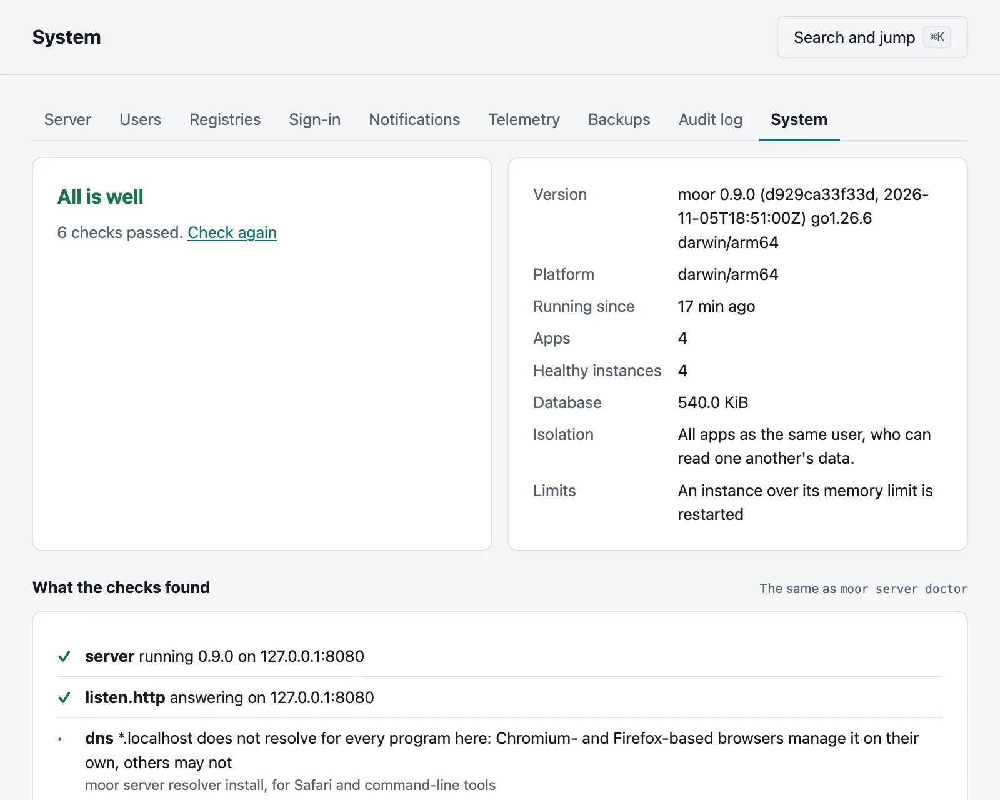
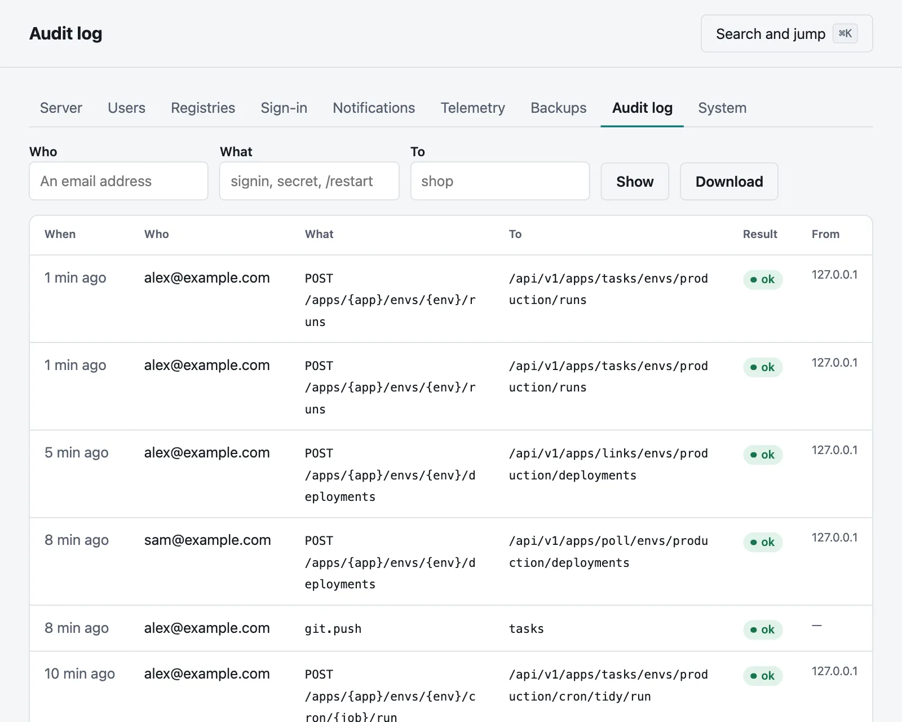

# Running a server

Moorage asks little of whoever runs it. This page says what to set up in the first week, what to look at after that, and
what changes as a server grows. [Installing Moorage](install.md) comes first.

## The first week

1. **Check it.** `moor server doctor` looks at the server and what it depends on, and says how to fix what it finds.

   ```bash
   sudo moor server doctor
   ```

2. **Decide about TLS,** if you have not. [A public CA](tls.md#from-a-public-ca-with-acme), or an intermediate from
   your company's, means nobody has to [trust anything by hand](tls.md#with-your-companys-ca).

3. **Keep apps apart.** On a shared Linux server, run as root and use `level = "user"` or `"sandbox"` in
   [`[isolation]`](configuration.md#isolation). `moor server doctor` and the **System** page say what you have.
   [How apps are kept apart](isolation.md) says what each gives you.

4. **Add people.** Give most people a role in a project, and only a few the administrator's. [Accounts and access](accounts.md)
   says how, and [How people sign in](sign-in.md) connects your identity provider.

5. **Back up.** Set a schedule in **Settings → Backups**, and **keep `keys/master.key` somewhere apart**: without it, the
   secrets in a backup cannot be read, and with it, anyone can. Then try a restore. See [Backups](backups.md).

6. **Be told.** Add a channel and a rule in **Settings → Notifications**, so that a failed deployment, a crash loop, a failed
   cron job, a full disk or a failed backup reaches someone. See [Notifications](notifications.md).

7. **Close the ports you do not use.** Moorage needs its HTTP and HTTPS ports, and the SSH port if you push over SSH. Apps
   are told to listen on loopback, and `moor server doctor` warns of one that can be reached another way.

## What to look at

The console's **Settings → System** has what the server runs, and what the checks find:



From the command line:

```bash
moor server status
```

```bash
sudo moor server doctor
```

```bash
moor events -f
```

**Who did what** is in the audit log, for a year: each change, sign-in, secret revealed and git push, with who and how it went, and
where from for all but pushes. **Settings → Audit log** searches and downloads it, and `moor audit` shows it.



**How it is doing** is in [metrics](metrics.md), for Prometheus as well as the console, and can go on to
[an OpenTelemetry collector](telemetry.md).

**The server's health** answers at `/.moorage/health` on every hostname, for whatever watches your machines.

## Where the disk goes

Everything is under the data directory, in plain files you can look at:

| Folder | What it holds | What limits it |
|---|---|---|
| `moorage.db` | The database | Grows slowly. Events go after 90 days, the audit log after a year |
| `repos` | Apps' git repositories | The size of their history |
| `builds` | Builds, and uploads for redeploying | `keep_releases` in each manifest: five by default |
| `data` | Apps' own data | The apps. Moorage keeps nothing of its own here |
| `logs` | Apps', deployments' and the server's logs | Rotation at 10 MiB, five files back, and 14 days for stopped instances. Deployments' logs stay until their app or environment goes |
| `toolchains`, `cache` | Toolchains and build caches | One copy of each version, shared by every app |
| `backups` | Database copies before each migration, and backups if you send them there | The last three migrations; your schedule's `keep` |
| `keys`, `certs` | The master key, SSH host keys and the CA | Small. **Back up `keys` apart** |

`moor server doctor` looks at free space, and a server tells those concerned when the data volume passes `disk_percent` in
[`[notifications]`](configuration.md#notifications), 90% by default.

Deleting an app removes its builds, logs and repository, and its data unless you keep it. Previews remove themselves when
their branch goes, or after seven days unused.

## As it grows

- **Let environments sleep.** An environment [asleep](previews.md#sleeping) uses no memory until a request wakes it, which is
  why a server can hold far more environments than it could run at once. [How big a machine](install.md#how-big-a-machine)
  has what we measured.
- **Limit what apps can use.** `[resources]` in a [manifest](manifest.md#resources) limits an instance's memory and CPU. They are
  enforced on Linux when the server runs as root with cgroup v2, and on Windows. Elsewhere, an instance over its memory limit is restarted.
- **There is one machine.** Moorage does not spread apps over several, and no version so far does. When a server is full, move
  some apps to another with [a backup and a restore](backups.md#restoring), or with their source.

## Stopping and restarting

Apps do not depend on the server being up. Stopping, restarting or upgrading it leaves them running and serving what is in
flight, and it takes them over again when it starts.

```bash
sudo moor server restart
```

```bash
sudo moor server stop
```

To stop the apps and their services too, whether or not the server is running:

```bash
sudo moor server stop --all
```

[When something is wrong](troubleshooting.md#stopping-everything) has more on that.

## Upgrading

```bash
sudo moor server upgrade
```

It checks what it downloads, keeps a copy of the database and of the binary, and goes back by itself if the new version does
not come up. See [Upgrading](install.md#upgrading).

## A checklist for a shared server

- Isolation at `user` or `sandbox`.
- Certificates from a public CA, an intermediate CA or files of your own, and not a root that everyone trusts by hand.
- The console on its own hostname, which is the default.
- Behind a proxy, the HTTP listener on loopback or a private address, and only the proxy's addresses in `[proxy] trusted`.
- Few administrators, and two-factor sign-in or single sign-on for them.
- Previews behind `login`, which is the default.
- `keys/master.key` backed up, and apart from your backups.
- A restore tried.
- A firewall in front of everything but the ports above.
- API tokens limited to one app and a scope, with an expiry, for each script.

[Security](security.md) says what these protect against, and what they do not.
