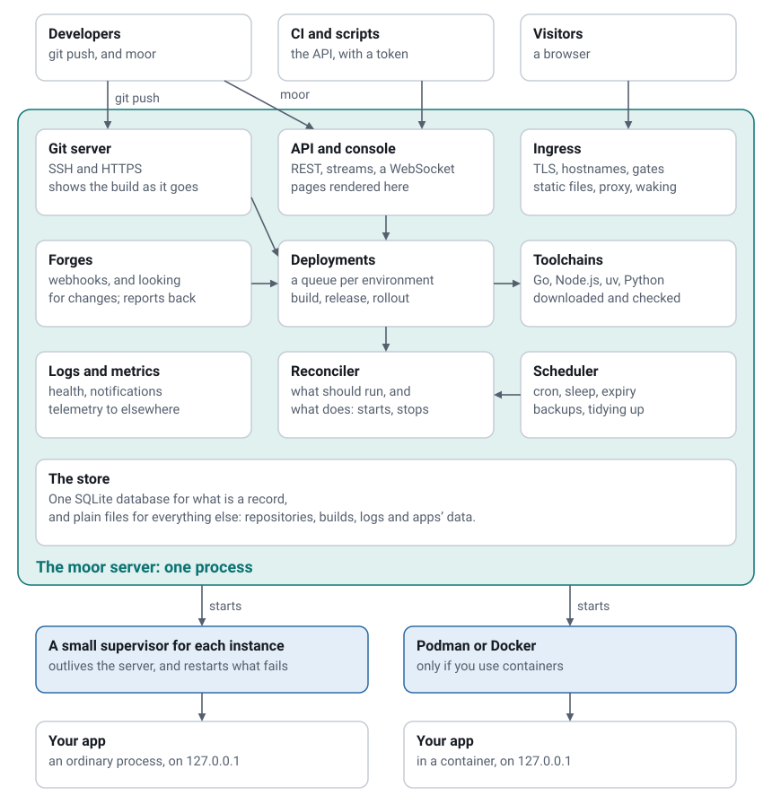

# Architecture

Moorage is one program on one machine. This page says how it is put together, for whoever runs it, wants to know what it does before
trusting it with something, or means to work on it. The [design documents](../spec/README.md) have a great deal more.



## What runs

Everything in the box above is one operating system process: the `moor` server. The only others Moorage starts are a small
supervisor for each native instance, called a **shim**, which is the same binary in another mode; the apps; builds while they run; and,
if you use containers, whatever the engine runs.

| Part | What it does |
|---|---|
| **Ingress** | Answers HTTP and HTTPS. Matches the hostname and path to an environment, applies its gate, serves static files itself or passes the request to a healthy instance, wakes what sleeps, and counts what it does. |
| **API and console** | A JSON API under `/api/v1`, with streams for logs and events and a WebSocket for terminals, and a console of pages rendered by the server with a little plain JavaScript. Both are thin layers over the same code. The command line uses the API. |
| **Git server** | Takes pushes over SSH and HTTPS into bare repositories on disk, and shows the deployment to whoever pushed. |
| **Forges** | Listens for webhooks and looks for changes on GitHub, GitLab and Gitea, and reports back to them. |
| **Deployments** | A queue for each environment, recorded in the database, which turns source into a release: toolchains, build, release command, rollout. |
| **Toolchains** | Downloads Go, Node.js, uv and Python, checks them, and keeps them per version. |
| **Reconciler** | Compares what should be running with what is, and makes them match. The only part that starts and stops instances. |
| **Scheduler** | Cron jobs, sleep, the expiry of previews, the removal of old things, backups and roll-ups. |
| **Logs and metrics** | Log files, health checks and metrics, with notifications and telemetry on top. |
| **Store** | One SQLite database for everything that is a record, and plain files for everything else. |

## Why apps survive the server

Each native instance is started through a shim. The server starts the shim, in a session of its own, and the shim starts the app. The
shim owns the app's output and writes it to its log, restarts the app if it exits, and answers the server on a loopback port with a secret
of its own. It stays small: a few megabytes each.

So when the server restarts, crashes or is upgraded, apps do not notice. As it starts, it finds its shims again from their state
files, and takes them over **before it opens its listeners**, so that traffic goes on to the same instances. If a shim itself dies, its
app is stopped with it, so that nothing is left running unknown, and the reconciler starts another.

Containers need no shim, as the engine keeps them alive. They are labelled, so that the server finds them again.

On Linux, the service unit lets the shims outlive the service, with `Delegate=yes` and `KillMode=process`, which is the arrangement container
engines use. Stopping them all is a choice: `moor server stop --all`.

## What should be running

The database says what should be running in each environment: its current release, how many instances of each process (none while it
sleeps), its routes and gate, and its variables. The reconciler compares that with what is running, whenever something relevant
happens and every 10 seconds regardless, and makes them match.

A rollout is a short sequence of those states: add the new instances, wait until they are healthy, move the routes, finish, remove the
old ones. A server that stops in the middle of one marks that deployment as failed when it comes back, and goes on with the
current release, so that nothing is left half done. See [How a release takes over](releases.md#how-a-release-takes-over).

## How things go

**A request to an app.** The listener, then TLS, then a look at a routing table that is immutable and swapped whole, so that a request never
sees half a change. Then the gate, then the static file, or the proxy to a healthy instance on `127.0.0.1`. Then the response, and the
metrics and access log.

**A `git push`.** SSH or HTTP sign-in, then whether you may push to this app. The pack goes into the bare repository, each branch is
matched to its environment, and its deployment runs, while its log goes back to you as git's progress messages. The branch is accepted
or refused by how that went, so that a failed deploy is a failed push.

**A page of the console.** The server renders it, with a session cookie and forms protected against forgery. A little JavaScript holds one
connection to the event stream for live status, and a page out of sight lets go of it, and catches up when it returns.

## Where everything is

The default locations are in [Server configuration](configuration.md#where-it-is). In the data directory:

```text
moorage.db                       the database (with -wal and -shm beside it)
keys/                            the master key, SSH host keys, tokens (private)
repos/<app>.git/                 bare git repositories
builds/<app>/<build>/            builds, which do not change once made
data/<app>/<env>/                apps' own data
logs/apps/<app>/<env>/           what instances wrote
logs/router/<app>/               access logs
logs/deployments/<app>/          deployments' logs
logs/server/moorage.log          the server's own
toolchains/<name>/<version>/     Go, Node.js, uv and Python, checked
cache/                           build caches
certs/                           the CA and certificates (private)
backups/                         copies of the database before migrating
run/                             shims' state, and the lock on the directory (private)
tmp/                             what is being unpacked or written (private)
upgrades/                        what an upgrade keeps, for going back
```

**You can look at all of it.** `ls` a build, `tail` a log, and `ps` an app, as it is an ordinary process. High-volume data does not go through the
database row by row: logs are files, and metrics are kept in memory and written in roll-ups.

The database is SQLite, in WAL mode, with one writer and a few readers. Its migrations only go forward, and a copy is taken before any of them
runs. A server refuses a database newer than it understands.

## Starting, stopping and upgrading

**Starting.** Open and migrate the database, mark as failed what was interrupted, load the keys, take over shims and containers, rebuild the
routing table, start the reconciler and scheduler, and only then open the listeners.

**Stopping.** Finish the requests under way, interrupt builds, and exit, **leaving apps running**. What the metrics held in memory for the
current minute is lost.

**Upgrading.** `moor server upgrade` downloads the new release, checks it, and asks it what it is. It then keeps a copy of the database and of the
binary, swaps the binary, and restarts the service. If the new version does not come up, it goes back by itself. Since the proxy, TLS and git
server are compiled in, there are no separately versioned parts to drift apart.

## On each system

| | Linux | macOS | Windows |
|---|---|---|---|
| Server, console, command line, git server, ingress, TLS | Yes | Yes | Yes |
| Go, Python, Node.js, static, your own commands | Yes | Yes | Yes |
| Containers | Podman or Docker | Podman or Docker Desktop | Podman or Docker Desktop |
| Apps survive the server | Yes | Yes | Yes |
| A user of its own for each app | Yes, as root | No | No |
| Limits on memory and CPU for native apps | cgroup v2, as root | Memory, by restarting | Job Objects |
| Limited to its own files | Landlock | No | No |
| Runs as a service | systemd | launchd | Windows service |
| A terminal in an app | Yes | Yes | ConPTY |

Linux is the reference for servers. CI runs the integration tests on Linux and Windows on amd64 and on macOS on arm64, and builds for all six platforms.

## How it is built

- **Pure Go, with no cgo.** `go build ./cmd/moor` is the entire build, and gives one static binary for each of six platforms. SQLite is a pure-Go
  port, and the console's templates, CSS and JavaScript are embedded.
- **No Node.js toolchain.** The console has no third-party code at all: Go templates on the server, hand-written CSS, and plain JavaScript.
- **Few dependencies,** each with a reason recorded in [the decisions](../spec/12-decisions.md).
- **Tested as it is used.** CI runs the race detector, drives the console in three browsers, and tries the installer, the service, upgrades, backups and
  isolation on real systems. See [Engineering practices](../spec/11-roadmap.md#engineering-practices-every-wave).

## Where it could go

Moorage is deliberately one machine, for now. The design leaves a seam between what decides and what runs, and running apps across machines is
in the [parking lot](../spec/11-roadmap.md#parking-lot), not on the schedule.
