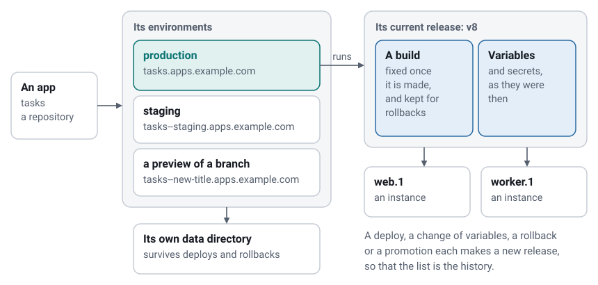

# Concepts

The words the rest of this documentation uses, and how the things they name fit together.

## The server

The **server** is the `moor` program, run as a service on one machine. It keeps its state in one SQLite database and
one data directory, and answers every app's hostname itself. There is nothing else to install, and no cluster: Moorage
is one machine, done well. The same program is also the **command line** you use from your own computer, which talks to
the server through its [API](api.md). The [web console](console.md) is part of the server, and shares its code with the API.

## Apps

An **app** is what you deploy, usually one repository. Its name becomes part of its address: `tasks` is served at
`tasks.apps.example.com`. Its `moorage.toml`, the [manifest](manifest.md), says how to build and run it, and is optional
when Moorage can work that out for itself.

## Environments

An **environment** is a place where an app runs, with its own address, variables, data directory and releases.

| | What it is | Address |
|---|---|---|
| **Production** | What the app is for. Every app has it | `tasks.apps.example.com` |
| **A named environment** | A place that stays, such as `staging` | `tasks--staging.apps.example.com` |
| **A preview** | A branch, made by pushing it, and gone when it goes | `tasks--new-title.apps.example.com` |

[Previews and environments](previews.md) has the details.

## Builds, releases and deployments

A **build** is what comes out of building one version of the source: a directory, or a container image. It does not
change afterwards.

A **release** is a build and a set of variables, numbered `v1`, `v2` and so on in each environment. Whatever changes what
runs makes a new one: a deploy, a change of variables, a rollback or a promotion. So the list of releases is the
history of what an environment ran, and going back to any of them takes a moment.

A **deployment** is the job that makes a release: build, or take a build there is already, run the release command, and
roll it out. It succeeds or fails, and if it fails, the release before it goes on serving. See
[Releases, rollbacks and scaling](releases.md).

## Processes and instances

A **process** is a kind of thing an app runs, named in its manifest. `web` gets the app's traffic, and an app may also
have others, such as `worker`, that do not. An **instance** is one running copy of a process. Each is watched by a small
supervisor that restarts it if it fails, and that keeps it running while the server itself restarts or is upgraded.

A **static site** has no processes at all: Moorage serves its files.

A **cron job** and a **one-off command** run as short-lived instances of the current release, with its variables and data
([more](cron.md)).

## Variables and secrets

**Variables** are what an app is configured with, kept on the server and given to it as its environment. A **secret** is a
variable sealed with the server's master key, which is handed to the app in memory and is not shown again
([more](variables.md)). Changing either makes a new release, unless you ask to keep the change for the next deploy.

## Data

The **data directory** of an environment survives deploys, and is at `$MOORAGE_DATA_DIR`. Everything else about a release
is read-only once built, which is why an app's own files belong in that directory ([more](interactive.md#the-data-directory)). It suits a
SQLite database, with [a dump for backups](backups.md#apps-with-databases). Moorage does not run other databases yet: reach yours through a
variable, such as `DATABASE_URL`. Services are [planned for 0.9.0](../spec/11-roadmap.md).

## Gates

A **gate** says who can reach an environment: anyone, whoever has a password, people signed in, or only those with a
share link. It can also be limited to a list of addresses ([more](access.md)).

## Projects, roles and tokens

Every app belongs to one **project**, and people have a **role** in a project:

| Role | What it adds |
|---|---|
| **Viewer** | Sees apps, status and metrics, and usually logs |
| **Deployer** | Deploys, restarts, rolls back, promotes, scales, and makes previews and share links |
| **Maintainer** | Changes variables, secrets, domains and gates, and members; deletes apps |
| **Administrator** | Everything on the server: settings, users, every project, and the audit log. This one is a role on the server, and not in a project |

An **API token** lets a script act as you, within the **scope** you give it: `read`, `deploy`, `admin` or `gate`. It can also
be limited to one app, and made to expire ([more](accounts.md)).

Deploying is running code on the server, so treat it like shell access: [Security](security.md) says what
that means.

## Runtimes and drivers

A **runtime** is how an app is built and started: Go, Python, Node.js, static, a command of your own, a `Containerfile`, or
an image. Moorage detects the common ones. Most run as ordinary processes on the server, and those in
[containers](containers.md) run under Podman or Docker. Nothing else needs an engine.

**Toolchains** are what the native runtimes are built with: Go, Node.js, uv and Python. Moorage downloads each one the
first time an app asks for it, checks it, and keeps it per version, so that every app gets the version it asked for.
