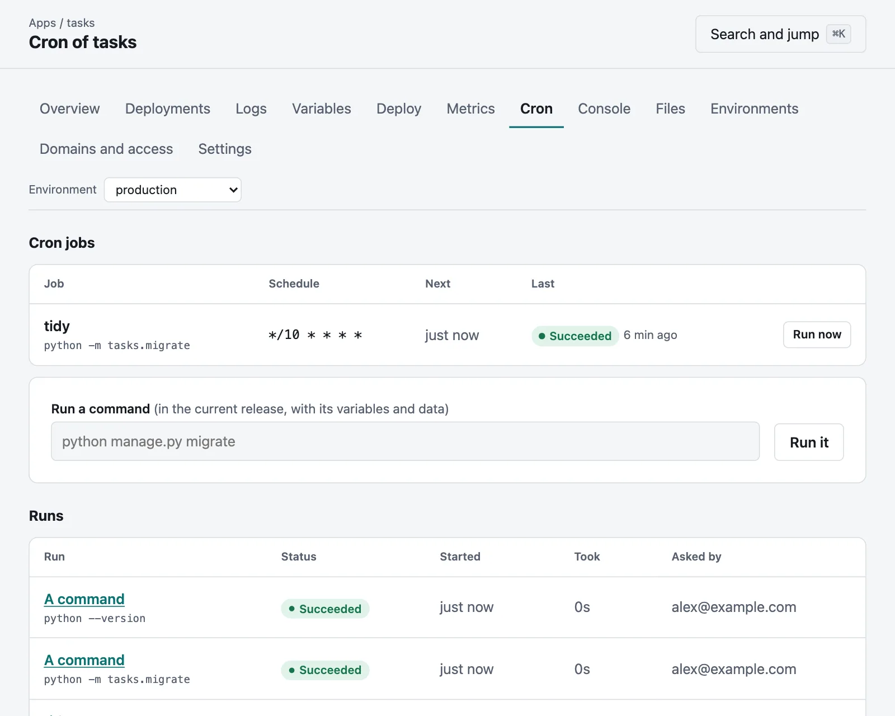

# Cron jobs and one-off commands

Both run as one-off instances of an environment's current release: the same build, variables and
data directory as its processes, for as long as the command takes.

## Cron jobs

Declare them in `moorage.toml`, and they run from the next deployment:



```toml
[[cron]]
name = "nightly-cleanup"
schedule = "0 3 * * *"
timezone = "Europe/Paris"
command = "python manage.py cleanup"
```

| Key | Default | |
|---|---|---|
| `name` | required | Its name, unique in the app. |
| `schedule` | required | Five fields (minute, hour, day, month, weekday), `@hourly`, `@daily`, `@weekly`, `@monthly`, `@yearly`, or `@every 15m`. |
| `command` | required | What to run. |
| `timezone` | the server's | Such as `Europe/Paris`. |
| `timeout` | `"1h"` | It is stopped after this long, a day at the most. |
| `overlap` | `"skip"` | If the run before is still going: `skip` this one, `allow` both, or `replace` the one before. |
| `environments` | `["production"]` | Where it runs. `"*"` is every environment that stays; previews need naming, as `"preview"`. |

A job that was due while the server was down waits for its next time. It runs in an
environment that is [asleep](previews.md#sleeping), without waking the rest of it.

```bash
moor cron
```

```bash
moor cron run nightly-cleanup
```

```bash
moor cron runs nightly-cleanup
```

```bash
moor cron log run_01J8ZQ
```

The last 100 runs of each job are kept, with what they said, how long they took and how they ended. A
job that fails is in [the activity](console.md#activity). An app's **Cron** tab in the console has its jobs, with when each next
runs and how it last went, and runs one now.

## One-off commands

```bash
moor run -- python manage.py migrate
```

```bash
moor run --env staging --timeout 10m -- ./seed.sh
```

What it says comes back as it says it, on standard output and standard error, and `moor` ends with its
exit status, so that a script can tell. Interrupting `moor` stops the command. `--detach` leaves it running.

It takes an hour at the most unless `--timeout` says otherwise, up to a day. A command that asks for input
gets none, unless you are [at a terminal](interactive.md#a-terminal), with `-it`. Running a command takes a deployer, as deploying does, and each is in
[the audit log](accounts.md#who-did-what). Secrets are kept out of what is recorded of its output.

The **Cron** tab in the console has a box to run one, too.

## Inside a run

`$MOORAGE_PROCESS` says what it is: `cron-nightly-cleanup` for a job, and `run` for a command. A release
command, which runs with each deployment, says `release`.
