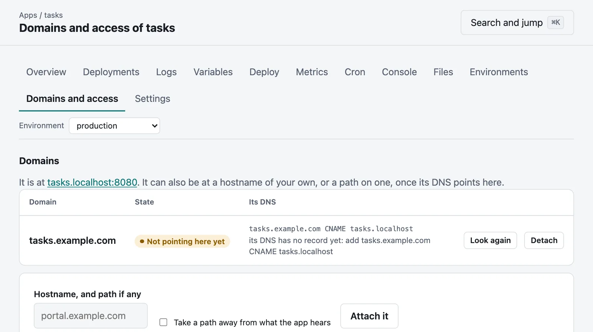

# Your own domains, and paths

An environment is at its own hostname under the server's domain, such as
`shop.apps.example.com`. It can also be at a hostname of your own, or a path on one, so that
several apps can share a hostname.



```bash
moor domains add portal.example.com --app shop
```

```bash
moor domains add tools.example.com/reports --app reports
```

## DNS

A domain serves nothing until its DNS is seen to point here, by either of:

- a **CNAME** to the environment's own hostname, which `moor domains` and the app's **Domains and access**
  tab show you, or
- an **A or AAAA record** with an address of this server.

Moorage looks when it is attached, then every few minutes, or when you ask:

```bash
moor domains verify portal.example.com
```

```bash
moor domains
```

```bash
moor domains remove portal.example.com
```

A domain goes with one environment, and takes `--env` like everything else. Attaching one takes a
maintainer. A hostname under the server's own domain is not needed: it names its apps by itself.

## Certificates

With `tls.mode = "acme"`, [a domain gets a certificate of its own](tls.md#from-a-public-ca-with-acme) the first time it is asked for, once its DNS points here.

The CA that Moorage makes for itself vouches only for the server's own domain, so that otherwise, HTTPS at another
hostname needs one of these:

- `[tls] mode = "files"` with [a certificate](tls.md) for that hostname, or
- [a proxy in front](proxy.md) that has one.

## A path on a hostname

Requests under the path go to the environment, and the longest path that fits wins. What an app must
know of it:

- **It hears the path as it was asked for,** and `X-Forwarded-Prefix` says what the path is. Most
  frameworks have a "root path" or "base" setting for this. `--strip-prefix` takes it away instead.
- **Its redirects and cookies are made to fit.** A `Location: /login` becomes `/reports/login`, and a cookie's
  path goes under `/reports/`.
- **What is in what it sends is its own affair.** Links in its pages are not rewritten: that goes wrong
  in ways nobody can see. Relative links always work; others need to take the path into account.
- **Static sites** work as long as their links are relative.

`/.moorage/` under the path belongs to Moorage. Prefer a hostname of its own for an app, if you can have
one: it is the only way it can be sure of having cookies and storage to itself.

## With no wildcard DNS: path routing

If you cannot have a wildcard DNS record, a whole server can give every app a path on one hostname, and
`/shop/`, `/docs/` and `/shop--staging/` take the place of hostnames:

```bash
moor server init --routing path --domain apps.example.com --console-host moorage.example.com
```

That needs two DNS records, and no wildcard. The console must have a hostname of its own, and the server
refuses to start without one: a page of any app on the console's own hostname could act as whoever is signed in.

- Each app hears its path, in `$MOORAGE_BASE_PATH` and `X-Forwarded-Prefix`, and `$MOORAGE_URL` says all of its
  address. `strip_prefix = true` in `[app]` takes it away from what it hears.
- **Apps share one origin.** A script in one page can read what another app's pages can, and cookies and browser
  storage are not kept apart. Use it where apps trust one another. Otherwise use hostnames: that is why
  they are the default.
