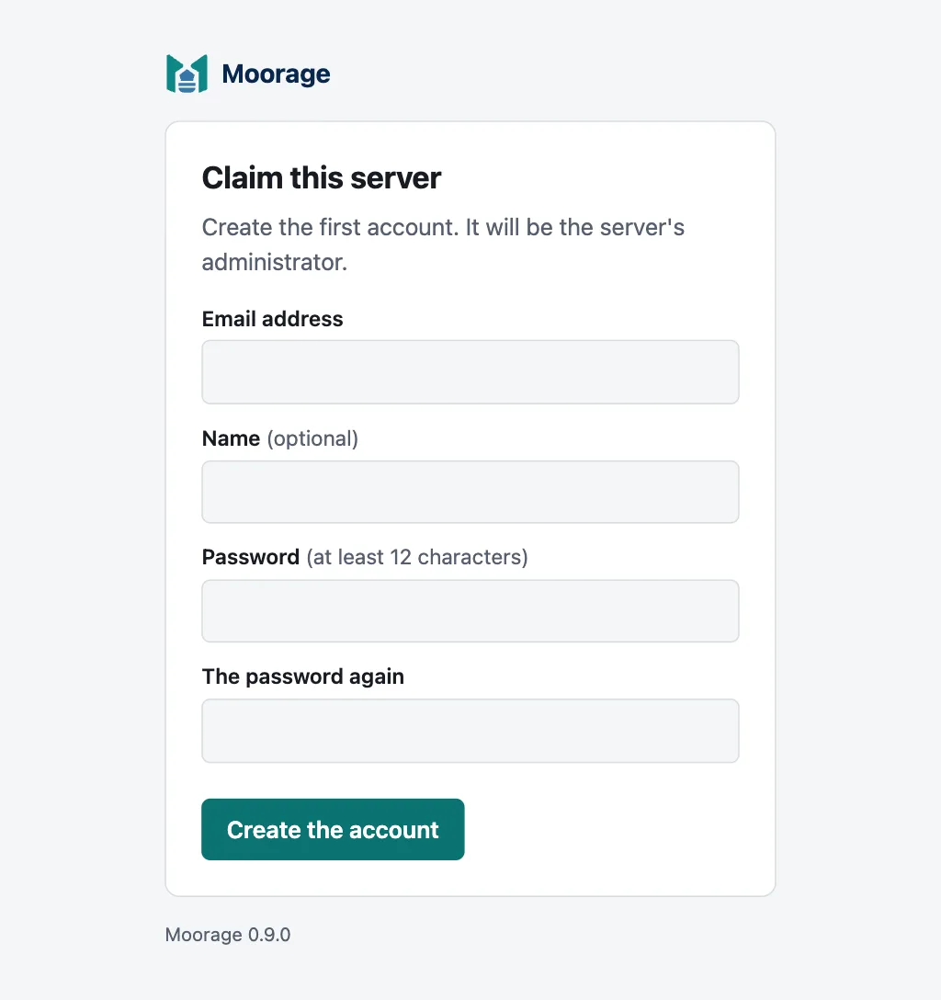
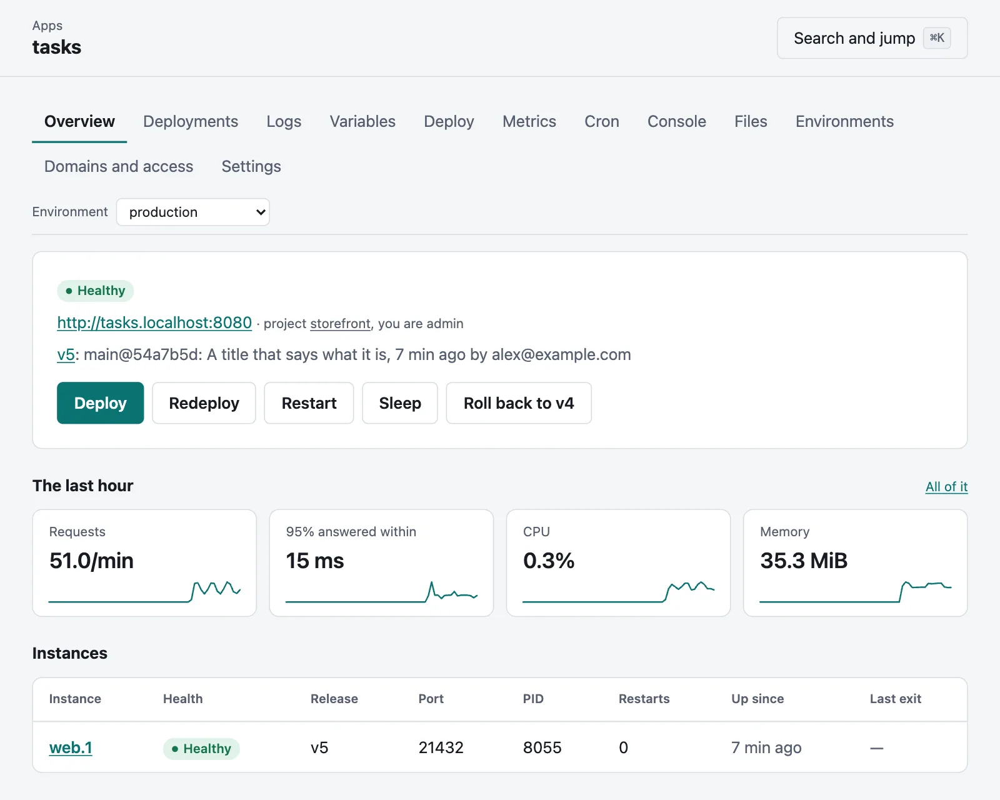
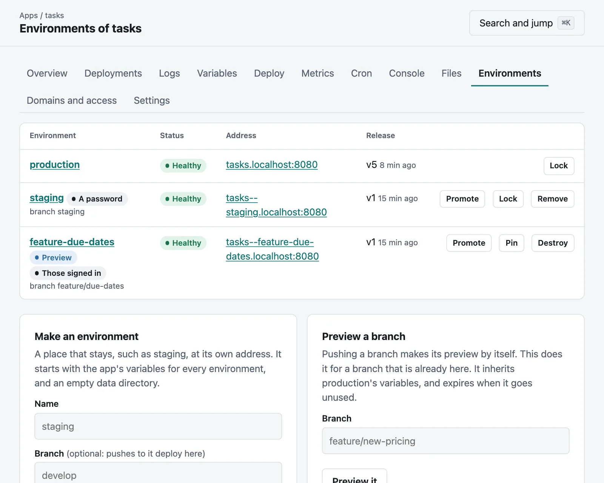
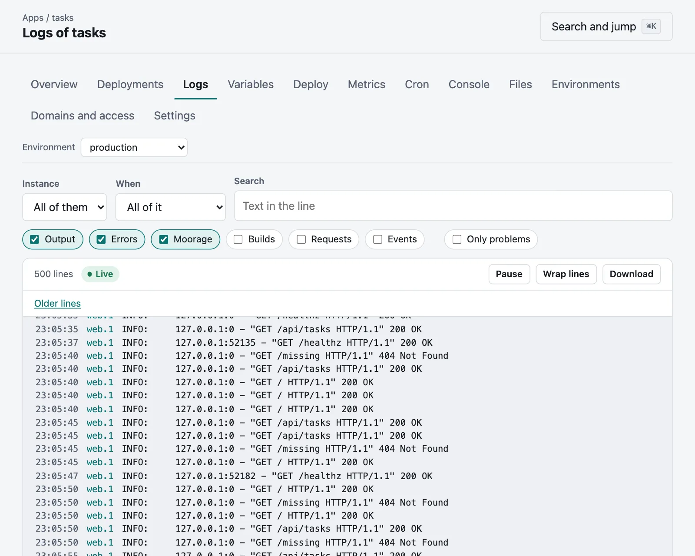

# Getting started

This takes you from nothing to an app with a URL, a preview of a branch and a rollback, on your own
computer, in about ten minutes. You need Git, a browser, and nothing else: no containers, no database and no
proxy. Moorage downloads the toolchains an app needs by itself.

## 1. Install `moor`

On macOS or Linux:

```bash
curl --proto '=https' --tlsv1.2 -fsSL https://raw.githubusercontent.com/robert-mcdermott/moorage/main/install.sh | sh
```

In PowerShell on Windows 11:

```powershell
irm https://raw.githubusercontent.com/robert-mcdermott/moorage/main/install.ps1 | iex
```

`moor` is one program: the server, and the command line that talks to it. The installer checks it against the
release's checksums, needs no administrator rights, and starts nothing. [Installing Moorage](install.md) has
everything else about it.

## 2. Start a server

```bash
moor server init --preset local
```

```bash
moor server run
```

The `local` preset is for this computer only: plain HTTP on `127.0.0.1:8080`, with apps at
`http://<app>.localhost:8080`. Leave it running, and use another terminal for the rest.

## 3. Claim it

`moor server init` printed a link, and `moor server status` shows it again. Open it, and create the first account,
which is the server's administrator. The link is what stops anyone else from doing this first.



The page then leads to **Getting started** in the console, which checks how the server is set up and watches for your
first deployment.

## 4. Deploy an app

The [examples](../examples/README.md) are complete apps, ready to deploy. Take the task list, which is FastAPI with a
small database, and make it a repository of its own:

```bash
git clone --depth 1 https://github.com/robert-mcdermott/moorage
```

```bash
cp -R moorage/examples/python-fastapi tasks
```

```bash
cd tasks
```

```bash
git init -b main
```

```bash
git add . && git commit -m "First commit"
```

Then deploy it:

```bash
moor deploy
```

On the server's own computer, `moor` needs no sign-in. It says what it is doing as it does it (some lines are left out
here):

```text
Created app tasks.
Uploaded 13 files (56.9 KiB); deployment dep_01M6MQN3BN394RAM4D6XRSASHR is queued.
moorage  tasks · production · dep_01M6MQN3BN394RAM4D6XRSASHR
▸ detected   python · uv latest (the python runtime) · python 3.13 (.python-version)
             web runs uvicorn on tasks.main:app
             verified uv-aarch64-apple-darwin.tar.gz (13.7 MiB, SHA-256 81b811b57e4624df…)
             installed uv 0.13.7
             installing Python 3.13.18 with uv 0.13.7
▸ toolchains uv 0.13.7, python 3.13.18
▸ install    uv sync --no-dev --locked
▸ built      883 files, 15.1 MiB in 4.3s
▸ release    v1: python -m tasks.migrate
             applied migration 1
             applied migration 2
▸ rollout    web ×1
✔ live       v1  http://tasks.localhost:8080  (5.2s)
```

Nothing told it this is Python: it looked. It fetched uv and the Python the app asks for, checked them against their
published checksums, installed the dependencies from `uv.lock`, ran the migrations in the app's `moorage.toml`, and
moved the traffic once the new instance answered its health check.

Open <http://tasks.localhost:8080>. Chromium- and Firefox-based browsers find `*.localhost` addresses by themselves;
for Safari and the command line, `moor server resolver install` sets that up.

The console, at <http://moorage.localhost:8080>, shows the same thing with more to look at:



## 5. Change it, and go back

A variable is part of a release, so changing one releases it, in less than a second and without downtime:

```bash
moor env set TASKS_TITLE="Team tasks"
```

```text
Set TASKS_TITLE for production of tasks.
Released v2 with the new variables.
```

Going back needs no build either, since the builds of recent releases are kept:

```bash
moor rollback
```

```text
tasks now serves v3 (the build bld_01M6MQN3BHZMBD3KD5WE8YK7D4).

  http://tasks.localhost:8080
```

A rollback is a new release of an earlier build, so that the record stays in order:

```bash
moor releases
```

```text
    RELEASE   REASON     FILES   SIZE       CREATED
*   v3        rollback   883     15.1 MiB   just now
    v2        config     883     15.1 MiB   just now
    v1        deploy     883     15.1 MiB   just now
```

It runs with the variables you have now. [Releases, rollbacks and scaling](releases.md) says more.

## 6. Push with git, and preview a branch

Add the server as a remote, and pushing deploys. The push shows the build, and fails if the deployment does:

```bash
moor git remote --http
```

```bash
git push moorage main
```

Any other branch gets a place of its own, with its own address, data and releases. Make a change on a branch:

```bash
git switch -c new-prompt
```

In `tasks/static/index.html`, change `What needs doing?` to something else, then:

```bash
git commit -am "Ask what is next"
```

```bash
git push moorage new-prompt
```

```text
remote: moorage  tasks · new-prompt · dep_01M6MSG6DQ00AF6M5CE1G9HAQR
remote: ▸ source     new-prompt @ e409bbf  Ask what is next
remote: ▸ built      883 files, 15.1 MiB in 600ms
remote: ▸ release    v1: python -m tasks.migrate
remote: ▸ rollout    web ×1
remote: ✔ live       v1  http://tasks--new-prompt.localhost:8080  (1.4s)
```

That build took just over half a second, as the toolchains and packages were already there. Open the address, and it asks
you to sign in: a preview is for those with a role in the app, unless you say otherwise.



Delete the branch, and the preview goes with it:

```bash
git push moorage --delete new-prompt
```

[Previews and environments](previews.md) has staging, promoting, locks and sleeping.

## 7. See how it is running

```bash
moor ps
```

```bash
moor logs -f
```

```bash
moor metrics
```

The console has the same as it happens. An app's **Logs** tab follows and searches what it says, and **Metrics** charts
its requests, response times, CPU and memory, with each release marked:



## 8. Clean up

This stops the server and every app on it:

```bash
moor server stop --all
```

To remove everything, delete `~/.moorage` as well (`%LocalAppData%\Moorage` on Windows). To keep trying things, start
it again with `moor server run`: everything is as you left it.

## Where to go next

- **Your own app:** run `moor deploy` in its directory. Moorage works out [Go](go.md), [Python](python.md),
  [Node.js](node.md) and [static sites](static.md) by itself, and runs [anything else](other.md) or
  [a container](containers.md) if you say how. `moor manifest explain` shows what it would do.
- **The words Moorage uses:** [Concepts](concepts.md) has them on one page.
- **A server for your team:** [install it as a service](install.md#3-run-it-as-a-service), with its own domain and
  certificates, then [add people](accounts.md#add-people). [Running a server](administration.md) says what to set up
  in the first week.
- **Deploying from GitHub, GitLab or Gitea:** [connect a repository](forges.md), and each pull request gets a preview.
