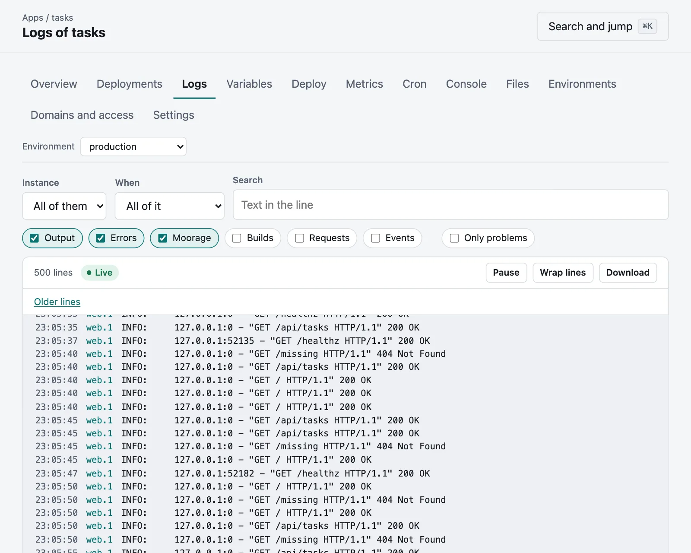

# Logs

Moorage captures what every instance writes to its standard output and standard error, with nothing to set up in the
app. An app should just write to them, a line at a time. It also keeps its builds' logs, a log of the requests it served,
and a record of what happened to it.

## In the console

An app's **Logs** tab shows what it says, as it says it: the output of every instance, merged by time.



- **Instance:** all of them, one process or one instance.
- **When:** the last 15 minutes up to the last 7 days, or between two moments.
- **Search:** the lines with this text, whatever its case, marked where it is.
- **Sources:** see below.
- **Only problems:** errors, warnings, standard error, and requests that failed.

**Pause** stops the lines moving, and **Resume** brings what came meanwhile. Scrolling up holds the view where it is, and
**Newest lines** comes back. **Older lines** goes further back, and **Download** gives you all of what is shown, up to
200,000 lines, as a file.

## From the command line

```bash
moor logs
```

Follow them, and narrow them down:

```bash
moor logs -f --process worker
```

```bash
moor logs --source stderr,build --since 1h --grep timeout
```

```bash
moor logs --problems --since 24h
```

Of the lines it prints, those marked `*` are Moorage's notes, and those marked `!` came from standard error.

`--since` takes how long ago (`15m`, `2h`, `7d`) or a moment, and `--json` prints each line as JSON for another program to
read. Its `--help` has the rest.

## What there is

| Source | What it is |
|---|---|
| `stdout`, `stderr` | What the app wrote |
| `moorage` | Moorage's notes of starts, exits and restarts, and why |
| `build` | The logs of its deployments |
| `access` | Its requests: who asked what, and how it went |
| `events` | [What happened](console.md#activity) to it: deployments, restarts, changes of variables |

The first three show unless you ask otherwise.

## Lines with structure

A line that is a JSON object reads as its message and fields, coloured by its `level`; hold the pointer over it in the
console to see the line itself. A line of plain text that names a level, as `ERROR:` or `level=warn`, is coloured too, and
both count for **Only problems**.

So there is nothing to configure for structured logs: write one JSON object to a line.

## Secrets

The values of an app's secrets are taken out of its output as it is captured, when they are six characters or more and appear
as they are. It is a safety net, and not a reason to log them: a value that has been encoded or cut in two gets through.

## How long they are kept

| | |
|---|---|
| Of an instance running | Until they rotate, at 10 MiB, with five files back |
| Of an instance that has stopped | 14 days |
| Of a deployment | For as long as its app and environment are there |
| Of the [events](console.md#activity) | 90 days |

They are plain files, in `logs` in the data directory, so that `tail` and `grep` work on them too:

```text
logs/apps/<app>/<env>/<process>.<index>.<instance>.log
logs/router/<app>/<env>.log
logs/deployments/<app>/<deployment>.log
logs/server/moorage.log
```

## Sending them elsewhere

To keep them longer, or with everything else you run, [send them on](telemetry.md) to syslog, an OpenTelemetry collector or
any HTTP endpoint. What is kept here stays as it is.
