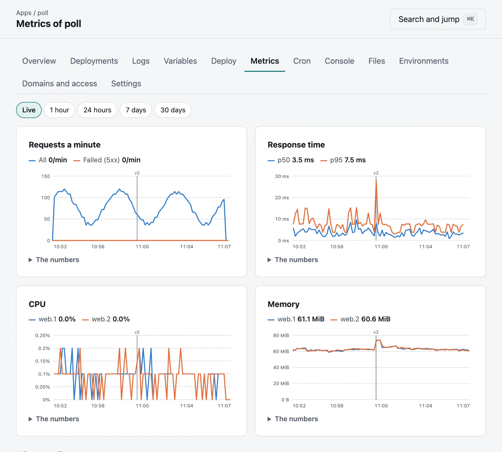

# Metrics

Moorage keeps what your apps have been doing, with nothing else to run. An app's **Metrics** tab has it as
charts, for each environment; **The last hour** on its page has it at a glance; and the list of
apps has each one's requests.



| Chart | What it is |
|---|---|
| **Requests a minute** | All requests, and those the app or Moorage failed (5xx). |
| **Response time** | How long 50% and 95% of them took, from when Moorage got them to when they ended. |
| **CPU** | By instance, in percent of one core, so that a process using two whole cores is at 200%. |
| **Memory** | By instance, and whatever each started. |

Each release is marked with its version on every chart, so that what changed lines up with what was deployed.
Hold the pointer over a chart for its numbers, or tab to it and use the arrow keys. **The numbers** under
each has them as a table, and every range works with no scripts at all.

Only requests that got through [a gate](access.md) are counted. A connection held open as a WebSocket counts as a
request, not as a response time.

## How long it is kept

| | Every | For |
|---|---|---|
| In memory | 10 seconds | 2 hours |
| In the database | Minute | 14 days |
| In the database | Hour | 1 year |

A restart of the server loses what was in memory, which is at most the current minute's worth that had
not been written. Percentiles stay right as they roll up, since it is histograms that are kept, and not averages of
averages. A busy environment with two instances takes about 6 MB of database, all told.

## From the command line

```bash
moor metrics
```

```bash
moor metrics --range 24h --series latency
```

```bash
moor metrics --env staging --json
```

`--range` is `live`, `1h`, `24h`, `7d` or `30d`.

## With Prometheus

The console's hostname answers at `/metrics`, with an API token that can read. It says only what the token's holder
could see anyway, and what is of the server itself only to an administrator.

```bash
moor tokens create prometheus --scope read
```

```yaml
scrape_configs:
  - job_name: moorage
    scheme: https
    authorization:
      credentials_file: /etc/prometheus/moorage-token
    static_configs:
      - targets: [moorage.apps.example.com]
```

| Metric | |
|---|---|
| `moorage_http_requests_total` | Requests, by `app`, `env` and status `class` |
| `moorage_http_response_bytes_total` | Bytes sent in answers |
| `moorage_http_requests_in_flight` | Requests going on now |
| `moorage_http_request_duration_seconds` | A histogram of how long they took |
| `moorage_instance_cpu_percent` | By `instance_name`, such as `web.1`, and `process` |
| `moorage_instance_memory_bytes` | The same |
| `moorage_host_load`, `moorage_host_memory_used_bytes`, `moorage_host_disk_used_percent` | The server itself |

Counts start again when the server does, as Prometheus expects of counters.

## How it is measured

On Linux and macOS, an instance's usage is added up over its process and all that descend from it. Containers' usage
comes from their engine. On Windows it is the same with what the system says of processes, and the server's load has
no number there.
