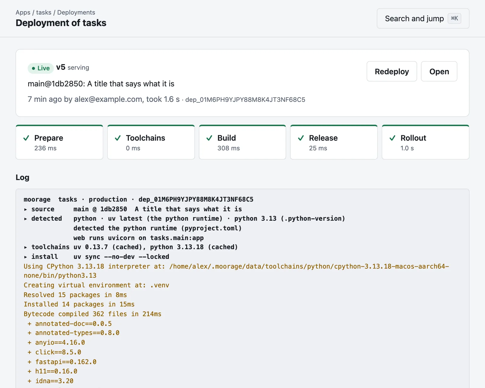
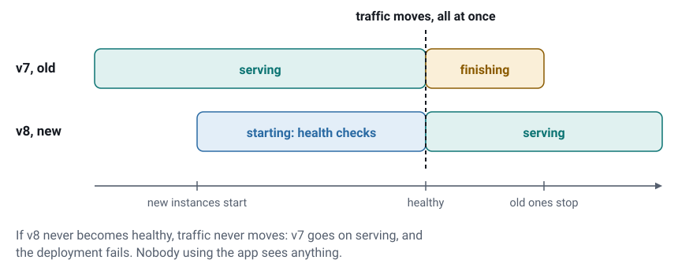
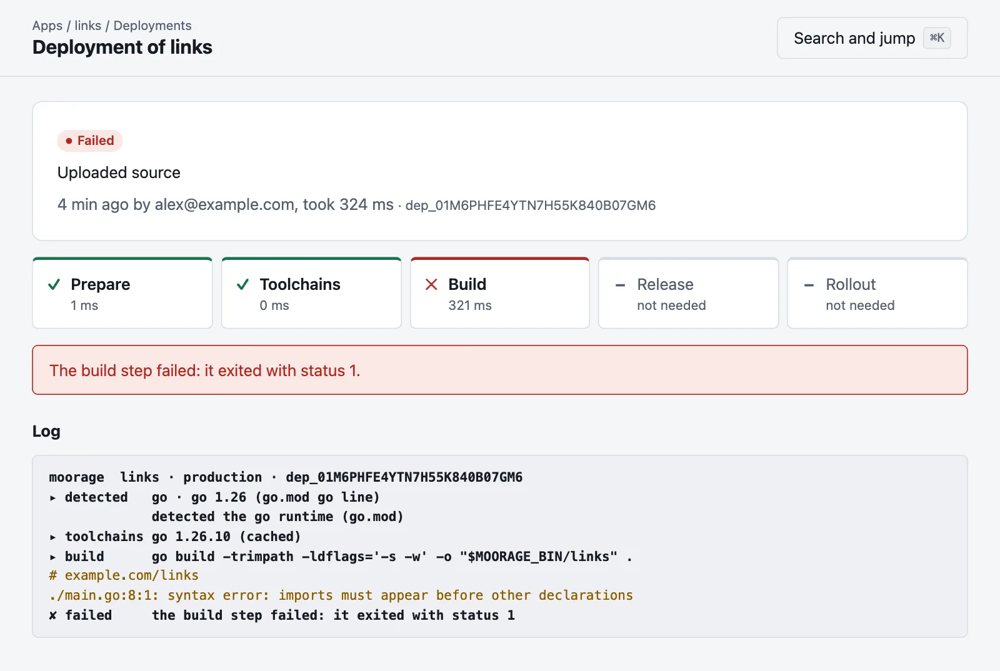

# Releases, rollbacks and scaling

Every change to what an environment runs makes a new **release**: a build and a set of variables. This page says how a
release takes over, what happens when one fails, and how to go back.

| What you do | What it does | Builds? | Runs the release command? |
|---|---|---|:-:|
| `moor deploy`, or a push | Builds the source, and rolls it out | Yes | Yes |
| `moor env set` | The same build with the new variables | No | No |
| `moor rollback` | An earlier build, with the variables you have now | No | No |
| `moor promote --from staging` | The build another environment runs, with this one's variables | No | Yes |
| `moor redeploy` | Builds what the current release was built from again | Yes | Yes |
| `moor restart` | Replaces the instances of the current release, and makes no new release | No | No |

## How a deployment goes



1. **Prepare.** It takes the source from the upload or the commit, and works out how to build it.
2. **Toolchains.** It fetches what the build needs, the first time anything asks for that version.
3. **Build.** It builds in the directory the release will run from, with `[build]` of the manifest, or as the runtime does.
4. **Release.** It runs `[release].command`, if there is one, once, with the release's variables. Database migrations go
   here. If this fails, the deployment fails, and the release before it goes on serving.
5. **Rollout.** New instances start, and take over.

One deployment runs at a time in an environment. A newer one replaces any still waiting, so that the latest push wins, and
builds across the server share a limit: half the CPUs by default.

## How a release takes over



1. New instances start beside the old ones, each on a port of its own.
2. Each is checked until it is healthy, for up to `health.startup` (60 seconds). With `health.path` it must answer that
   path with a 2xx or 3xx. Without it, a TCP connection to `$PORT` is enough, so give it a path if it matters.
3. The traffic moves, all at once.
4. The old instances finish their requests, for up to `deploy.drain` (30 seconds). Long-lived connections are closed at the
   end of that time.
5. They get their stop signal, and are killed if they have not stopped after `stop_timeout` (30 seconds).

**So an app should stop cleanly on `SIGTERM`,** and be able to run beside its previous version for a moment, as both are up
during a rollout. Where that cannot work, `strategy = "recreate"` in [`[deploy]`](manifest.md#deploy) stops the old
instances first, which means some downtime.

A process that takes no traffic, such as a `worker`, overlaps in the same way: the new one starts, and then the old one stops.

A **static site** has nothing to start. Its files are switched at once.

## When a deployment fails

If the build fails, the release command fails, or a new instance does not become healthy in time, the new instances are
stopped and the traffic never moves, so that with the default rolling strategy nobody using the app sees anything. The page says what went
wrong, and shows the log:



The app's page and the list of apps then show that its last deployment failed, beside the release that is still
serving. A `git push` fails too, and says why, so that you need not go and look. [Notifications](notifications.md) can
tell the people concerned.

A deployment interrupted by the server restarting is marked as failed: deploy or push again.

## Rolling back

```bash
moor rollback
```

That serves the release before this one again, as a new release, in about a second, as nothing has to be built. Name a
release to go further back:

```bash
moor rollback v3
```

It runs with **the variables you have now**, so that a secret you have since replaced stays replaced. To have those the
earlier release ran with:

```bash
moor rollback v3 --with-config
```

The release command does not run again, and **a rollback does not undo what a release did to its data.** If a migration
changed the database, the older code gets the newer database, so write migrations that the previous release can run
beside. That is what it must do during a rollout anyway.

In the console, **Roll back** on an app's page goes to the release before, and a deployment's page goes back to that one.

## Looking at releases

```bash
moor releases
```

```bash
moor releases show v3
```

```bash
moor releases diff v3 v4
```

`diff` says whether the build changed, which lines of the resolved manifest did, and which variables were added, changed or
removed: their names, and never their values.

Builds are kept for as long as one of an environment's last `keep_releases` releases (five, by default) uses them, and
what an environment is running now is never removed. A release whose build has gone cannot be rolled back to, and the
console says so.

## Scaling

```bash
moor scale web=3 worker=1
```

New instances start beside those running, and take traffic once they are healthy. Those beyond the number finish their
requests and stop. If a new instance cannot start, the app goes back to how it was, and says why. The number stays, over the
manifest's `instances`, through restarts and the releases to come, and the console says what the manifest would have had.
`0` turns a process off, and 20 is the most.

Requests are spread over the healthy instances. An instance holds nothing in common with another unless you arrange
it, so that an app with more than one needs to keep what it shares somewhere they can all reach.

An app that keeps something in memory for each visitor, as many keep a session, can ask to have each browser kept with one instance:

```toml
[processes.web]
instances = 3
sticky = true
```

Moorage does that with a cookie of its own, which the app does not hear, for as long as the browser is open. A browser moves to another instance
when its instance is gone or unhealthy, as it is after every release, so that what was in memory is lost then: it makes an app work
with several instances, and not safe to lose one.

This is one machine: scaling lets an app use more of its CPUs, and does not add to them.

## Restarts and crashes

An instance that exits is restarted, by the small supervisor that runs it, even while the server itself is away. The wait
between restarts starts at a second and doubles, up to a minute. An instance that keeps failing, five times in ten minutes,
counts as crashed, and is then restarted every five minutes. [Those concerned are told](notifications.md) sooner, at three exits in
five minutes.

An instance that fails its health check `threshold` times in a row (three) gets no traffic, and is restarted if it goes on failing for as
many again.

`restart` in [`[processes]`](manifest.md#processes) changes this: `always`, `on-failure`, or `never`.

## Keeping deployments out

```bash
moor lock
```

```bash
moor unlock
```

A locked environment takes no deployments, however they arrive, as after a rollback, while what went wrong is looked into.
Rollbacks and changes of variables go on working. [Previews and environments](previews.md#locks) has more.
