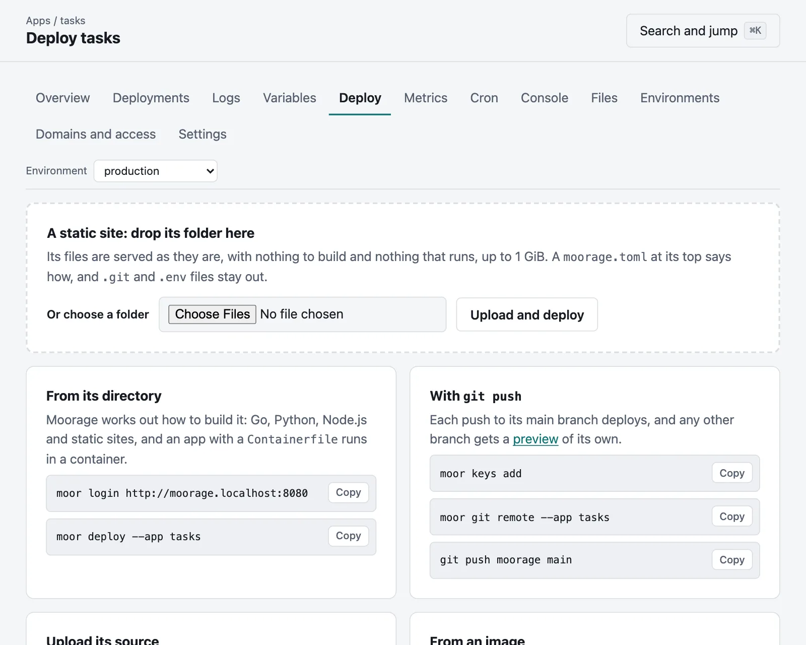

# Deploying a static site

A directory of files — documentation, a report, a single-page app — is served
as it is, from Moorage itself: no process runs for it.

## Upload a directory

```bash
moor deploy --static ./public --app docs
```

Every deploy is a new release, swapped in at once; `moor rollback` brings
the previous one back in a moment.

## Or drop its folder in the console

On an app's **Deploy** page, drop a folder on the box at the top, or choose one. It goes up and is
live a moment later, with nothing to install, and a new app that way is made for it as well.



What is in one folder is taken to be the site, so that `site/index.html` is the front page. `.git`,
`.env`, `.env.*` and the clutter that operating systems leave are left out, since whoever drops a
folder does not see what is hidden in it, and the deployment's log says what was. A `moorage.toml`
at its top says how to serve it, as [below](#serving-rules), and [who may reach it](access.md), and is
not served itself. A folder with
a `moorage.toml` for an app that builds or runs is refused, as it would serve that app's source:
upload that as source instead.

## Or build it

From source, Moorage detects a static site when the directory has an
`index.html` (at the top or in `dist`, `build`, `out`, `public`, `_site` or
`site`), and runs a build command first if you give one:

```toml
[app]
name = "docs"
runtime = "static"
toolchains = ["hugo@system"]   # the server's own hugo

[build]
command = "hugo --minify"

[static]
dir = "public"
```

```bash
moor deploy
```

A Node.js project without a `start` script is served the same way, from
the output of its build (see [Node.js](node.md)).

## Every release at its own address

Each release of a static site that is still kept can be seen at an address of its own, as it was
when it was deployed, to compare versions or to show someone an exact build:

```text
https://docs--production--v12.apps.example.com
```

`moor releases` lists them, and the **view** link in an app's **Deployments** goes to them.

This takes a certificate for those addresses. A server that [gets one for each hostname from a CA](tls.md#from-a-public-ca-with-acme) does not ask for them,
since anyone could then spend the CA's limit for your domain by visiting them, so that it does not offer them either. A
[wildcard](tls.md#from-a-public-ca-with-acme) covers them. The other ways of getting a certificate do too.

```bash
moor releases --app docs
```

They are behind the gate that the environment has now, so that closing an environment closes its
old releases too, and they tell search engines to stay away. Moorage keeps an app's last five
releases, or as many as [`keep_releases`](manifest.md#deploy) says. They need the same wildcard
DNS record as the rest of your apps, so that with [path routing](domains.md#with-no-wildcard-dns-path-routing) there are none.

## Serving rules

`[static]` says how files are served:

```toml
[static]
dir = "dist"
spa = true                 # serve index.html for unknown paths
clean_urls = true          # /about serves about.html
not_found = "404.html"
trailing_slash = "auto"    # or "always", "never"

[[static.headers]]
for = "/assets/*"
values = { "Cache-Control" = "public, max-age=31536000, immutable" }

[[static.redirects]]
from = "/blog/:year/*"
to = "/posts/:year/:splat"
status = 301
```

Files whose names carry a content hash (`app.3f2a9c1b.js`) are cached as
immutable, HTML is revalidated, and pre-compressed `.br` and `.gz` files are
served to browsers that accept them. `listing = true` lists directories, for
file shares.

Files and directories whose names start with a dot are as good as absent, since `.env` and `.git` are far more
often left behind than meant to be served. `.well-known` is the exception, and `dotfiles = true` serves the others.

A complete site: the [Handbook example](../examples/static-site), with clean
URLs, a 404 page, headers and redirects.
