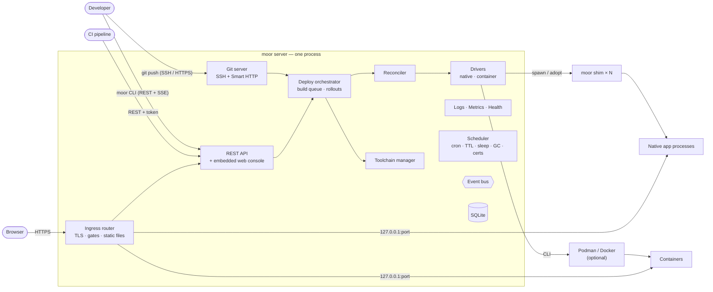

# 2. Architecture

## System context



Everything inside the box is one OS process: `moor server`. The only other
processes Moorage creates are one small `moor shim` per native instance (the
same binary in a different mode), the apps themselves, short-lived build
processes, and — if containers are used — whatever the container engine runs.

## Components

| Component | Responsibility |
|---|---|
| **Ingress router** | Terminates HTTP/HTTPS on :80/:443, obtains and renews certificates, matches host + path to an environment, enforces access gates, serves static releases directly, load-balances across healthy instances, wakes sleeping environments, records per-route metrics. ([details](06-ingress.md)) |
| **REST API + console** | Versioned JSON API under `/api/v1` (SSE streams for logs/events, WebSocket for interactive sessions) and the embedded web console: server-rendered HTML pages with small plain-JavaScript modules for live updates. Both are thin layers over the same service layer. ([details](09-interfaces.md)) |
| **Git server** | Accepts `git push` over SSH (built-in server, default port 2222) and Smart HTTP (`/git/<app>.git` on the console host). Stores bare repositories, authenticates users by SSH key or token, maps branches to environments, streams deploy progress back to the pusher. ([details](04-build-and-deploy.md#git-server)) |
| **Deploy orchestrator** | Persistent job queue. Turns a source revision into a release (checkout → detect → toolchains → build → package), runs the release command, and drives the rollout through the reconciler. ([details](04-build-and-deploy.md)) |
| **Toolchain manager** | Downloads, verifies (checksums) and caches language runtimes and tools: Go, Node, Bun, Deno, uv and uv-managed Python, with more added over time. |
| **Reconciler** | Compares desired state (DB) with actual state (drivers) per environment and converges: start/stop instances, update the routing table, apply scale changes, restart crashed instances. |
| **Drivers** | `native`: launches instances through `moor shim`. `container`: drives Podman or Docker through their CLI. Both implement one interface. ([details](05-runtime.md)) |
| **Observability** | Log capture and streaming, metrics sampling and storage, health checks, activity timeline, notifications. ([details](07-observability.md)) |
| **Scheduler** | Cron jobs, preview TTL expiry, idle sleep, release/image/log garbage collection, certificate renewal, metric roll-ups, backups. |
| **Event bus** | In-process typed pub/sub. Components publish state changes; the console, CLI streams, notifications and the activity log subscribe. |
| **Store** | SQLite (WAL mode) for all metadata and configuration; plain files for repositories, releases, logs and app data. ([details](10-data-model.md)) |

## Process model

### The daemon

`moor server` runs as a system service (systemd unit, launchd daemon or
Windows service — installed by `moor server install`). It is the only
long-lived Moorage process that holds state in memory, and all of that state
is reconstructible from SQLite plus the drivers.

### Shims: apps survive daemon restarts

Each native instance is started through a **shim**: the daemon spawns
`moor shim --instance <id>` in its own session/process group, and the shim
spawns the app. The shim:

- owns the app's stdin/stdout/stderr and writes timestamped log lines to the
  instance's log file (with size-based rotation);
- applies the restart policy locally (with backoff), so a crashing app is
  restarted even while the daemon is down or upgrading;
- starts the app under its per-instance OS controls (Linux: the app is
  spawned into its cgroup through a tiny exec helper — `moor` re-executed in
  the child — that switches user/group, applies Landlock and `no_new_privs`,
  then `exec`s the app, leaving the shim itself unrestricted; Windows: a Job
  Object);
- records the app's PID, start time and exit statuses in a small state file;
- takes commands from the server on a loopback TCP port, guarded by a per-shim
  secret (UNIX socket paths are too short on macOS for deep data directories),
  speaking newline-
  delimited JSON: `status`, `signal`, `stop`, `wait`;
- exits when the app is stopped on purpose.

When the daemon restarts (crash, upgrade, config change) it re-discovers
shims through their sockets and state files and **adopts** them; apps keep
serving the whole time. If a shim dies unexpectedly, its app is killed too, so
there are no orphans, and the reconciler starts a fresh instance:

- **Linux:** a parent-death signal (set from a dedicated, locked OS thread,
  because Linux ties that signal to the creating *thread*), backed by killing
  the instance's cgroup.
- **Windows:** the shim's Job Object is created with kill-on-close.
- **macOS:** there is no parent-death signal, so the daemon kills the orphaned
  process group — identified by PID *and* start time, to be safe against PID
  reuse — before starting a replacement.

Shims must stay small: the `shim` code path avoids touching heavy packages,
and package `init()` functions across the codebase must be cheap. Budget:
**≤ 5 MB private RSS per shim** (measured in wave 1 at 4.4–5.3 MB on Linux
and 6.2 MB on macOS, around it; fallback is one shim per environment instead
of per instance).

### Linux: service unit and cgroup layout

Service managers normally kill everything a service started when the service
stops — which would defeat the shims. On Linux the systemd unit is therefore
configured with `Delegate=yes`, `KillMode=process` and `TasksMax=infinity` (the
same arrangement container engines use so containers outlive their daemon).

Limits go in a top-level group of the server's own, with the shims left where
they started, so that a shim survives an OOM kill of its app and reports it:

```text
/sys/fs/cgroup/moorage/
  apps/<instance>/              the app's process tree: memory.max, cpu.max, pids.max, memory.oom.group=1
  builds/<build-id>/            build processes: a reduced cpu.weight
```

They are not under the service's own group, since a group with controllers
enabled for its children may hold no processes itself: a systemd older than 254,
which has no `DelegateSubgroup`, could then not restart the service, which it starts
in that group. A server not running as root has no cgroups, and watches memory
instead.

- `KillMode=process` means `systemctl restart moorage` stops only the daemon;
  the delegated subtree — shims and apps — is left alone.
- `TasksMax=infinity` because the default per-service task limit would
  otherwise cap all apps on the server *together*; per-instance `pids.max`
  provides the real limits.
- On host shutdown the daemon holds a shutdown inhibitor ("delay" lock) and
  stops apps gracefully before the system kills what is left;
  `moor server stop --all` does the same on demand.
- Apps are spawned directly into their cgroup (clone-into-cgroup, Linux ≥ 5.7, and
  without it there are no cgroups) and what is left of them is stopped with
  `cgroup.kill` (Linux ≥ 5.14) as well as by process group.

### Containers

Containers do not use shims: the container engine already keeps containers
alive independently of Moorage. Containers are labelled
(`io.moorage.instance=<id>` etc.) so the daemon can adopt them after restart,
and their logs are read back from the engine with `--since`, so nothing is
lost while the daemon is down.

### Driver interface (sketch)

```go
type Driver interface {
    Name() string
    Start(ctx context.Context, spec InstanceSpec) (InstanceState, error)
    Stop(ctx context.Context, id string, grace time.Duration) error
    Signal(ctx context.Context, id string, sig Signal) error
    Inspect(ctx context.Context, id string) (InstanceState, error)
    List(ctx context.Context) ([]InstanceState, error) // adoption after restart
    Logs(ctx context.Context, id string, opts LogOptions) (LogStream, error)
    Stats(ctx context.Context, id string) (Stats, error)
}
```

`InstanceSpec` contains the release path or image, command, environment,
assigned port, working directory, data directory, resource limits and
isolation settings. Drivers know nothing about routing, deployments or the
database.

## Desired state and reconciliation

Moorage is **level-triggered**: the database records what should be running
and the reconciler makes it so.

For each environment the desired state is:

- the **current release** (or none),
- the **formation** — instance count per process type (0 when sleeping),
- the **routes** (hostnames/paths) and access gate,
- the **runtime configuration** (env vars, limits) — a hash of which is
  stamped on every instance.

The reconciler runs on every relevant event (deploy, scale, config change,
instance exit, health change) and on a 10-second safety tick. It is the only
component that starts or stops instances, and it publishes routing-table
updates to the ingress. Rollouts are expressed as a short sequence of desired
states (add new instances → wait healthy → switch routes → drain → remove old),
so a daemon crash in the middle of a rollout resumes cleanly on restart.

## Key request paths

**HTTP request to an app.** Listener → TLS (SNI → certificate) → route lookup
in an immutable, atomically swapped routing table → access gate → static file
or reverse proxy to a healthy instance on `127.0.0.1:<port>` → response,
metrics and access-log sampling.

**`git push`.** SSH or HTTP auth → authorisation for the app → receive the
pack into the bare repository → pre-receive: resolve each ref's target
environment and run its deployment, streaming log lines back to the client as
git progress messages → accept or reject each ref according to the outcome →
report ref status.

**Console.** The daemon renders pages with Go templates on the console
hostname (session cookie, CSRF-protected HTML forms) from the same service
layer the API uses. Small plain-JavaScript modules keep one SSE connection to
`/api/v1/events/stream` for live status and stream logs and deployment output. A page
out of sight closes it, and catches up from the last event when it returns: over plain
HTTP a browser allows six connections to a server, and each open tab would hold one.

## On-disk layout

Default locations, when neither a flag nor `MOORAGE_CONFIG` /
`MOORAGE_DATA_DIR` says otherwise — system-wide when `moor` runs as root (an
elevated Administrator on Windows), per-user otherwise (laptop mode):

| Platform | Configuration (system / per-user) | Data directory (system / per-user) |
|---|---|---|
| Linux | `/etc/moorage/server.toml` / `~/.moorage/server.toml` | `/var/lib/moorage` / `~/.moorage/data` (`XDG_CONFIG_HOME` and `XDG_DATA_HOME` win, if set) |
| macOS | `/Library/Application Support/Moorage/server.toml` / `~/.moorage/server.toml` | `/Library/Application Support/Moorage` / `~/.moorage/data` |
| Windows | `%ProgramData%\Moorage\server.toml` / `%LocalAppData%\Moorage\server.toml` | the same directory as the configuration |

A per-user server set up by a version before 0.4.0 stays where it was
(`~/.config/moorage` and `~/.local/share/moorage` on Linux, `~/Library/Application
Support/Moorage` on macOS): `moor` looks there when `~/.moorage` has no configuration.

```
<data>/
  moorage.db                      SQLite database (+ -wal, -shm)
  keys/                           master key, SSH host keys, internal CA (0700)
  repos/<app>.git/                bare git repositories
  builds/<app>/<build-id>/        immutable build outputs (built in place), and
                                  source.tar.gz: an upload, for a redeploy
  data/<app>/<env>/               persistent data directories
  logs/
    apps/<app>/<env>/<process>.<index>.<instance>.log[.N]
    router/<app>/<env>.log[.N]   access logs
    builds/<deployment>.log
    server/moorage.log
  toolchains/<name>/<version>/    verified runtimes (go, node, uv, python, …)
  cache/<toolchain>/              shared build caches (module, package, uv caches)
  certs/                          CA material, certificates, later the ACME account (0700)
  backups/                        database snapshots taken before migrating; later, backups (0700)
  run/                            (0700)
    moor.lock                     held by the running server: one server per data directory
    shims/<instance>.spec.json    what a shim runs (0600: the environment may hold secrets)
    shims/<instance>.state.json   a shim's state and control address
    moor.sock                     local admin socket (root/service user only)
  tmp/                            (0700)
```

## Configuration

Configuration is split so that the file on disk stays tiny:

- **Bootstrap (`server.toml`, flags, `MOORAGE_*` env vars):** data directory,
  listen addresses, base domain, console hostname, TLS mode, trusted proxies,
  SSH port. Things
  needed before the database is open, or that an operator wants in
  configuration management.
- **Runtime settings (SQLite, edited in the console or with
  `moor server config`):** everything else — default limits, preview policy,
  notification channels, toolchain mirrors, container engine, retention.

`moor server init` writes the bootstrap file interactively (or from flags) and
offers three presets:

| Preset | Domain | TLS | Typical use |
|---|---|---|---|
| `lan` *(default)* | your internal wildcard domain | Moorage terminates TLS (auto-generated CA, an intermediate from your corporate CA, or certificate files), **or** plain HTTP behind your own TLS proxy | Corporate network — the initial target |
| `local` | `*.localhost` ¹ | off (HTTP on :8080) or internal CA | Laptop mode |
| `public` *(Phase 3)* | your public wildcard domain | ACME (automatic) | Internet-reachable server |

¹ Chromium- and Firefox-based browsers resolve `*.localhost` to the loopback
address on their own, as does systemd-resolved on Linux. The macOS and Windows
system resolvers do not, so other clients (Safari, CLI tools, scripts) need
help: `moor server resolver install` offers — opt-in, because it changes system
configuration — a resolver rule on macOS (`/etc/resolver/localhost`) pointing
at a tiny loopback-only DNS responder built into Moorage (`listen.dns`). On
Windows, a managed block of hosts-file entries comes with the Windows server, in
wave 7.

A complete bootstrap file is a handful of lines:

```toml
# /etc/moorage/server.toml — written by `moor server init`
data_dir     = "/var/lib/moorage"
domain       = "apps.example.com"
console_host = "moorage.apps.example.com"
routing      = "host"          # host | path

[listen]
http  = ":80"
https = ":443"
ssh   = ":2222"

[tls]
mode    = "internal"           # internal | files | off   (acme: Phase 3)
# Optional: sign with an intermediate issued by your corporate CA, so every
# certificate Moorage issues is already trusted by company machines.
# Without these two lines Moorage generates its own self-signed root.
ca_cert = "/etc/moorage/tls/intermediate.crt"
ca_key  = "/etc/moorage/tls/intermediate.key"
```

To run plain HTTP behind an existing TLS proxy such as nginx instead, set
`mode = "off"` and list the proxy under `[proxy]` — see
[Ingress → Deployment topologies](06-ingress.md#deployment-topologies).

### Install walkthrough

1. Install `moor`: `install.sh` piped from `curl` on macOS and Linux, or
   `install.ps1` piped into `iex` on Windows, which pick the file for the platform
   and check it against the release's checksums. As root, it goes to
   `/usr/local/bin`.
2. `sudo moor server init` asks a few questions — preset, domain, whether
   Moorage terminates TLS or sits behind your TLS proxy, admin email — checks
   DNS and ports as it goes, and writes `server.toml`. Behind a proxy, it also
   prints the matching proxy configuration.
3. `sudo moor server install` registers and starts the service (systemd,
   launchd or Windows service).
4. Create the wildcard DNS record the init step printed (skipped for
   `local`).
5. Open the one-time setup URL printed by `init` to create the admin password,
   then follow the console's "deploy your first app" commands.

`moor server doctor` can be run at any time to re-check DNS, ports, TLS, the
container engine and Linux kernel features, printing a fix for each problem.

## Startup and shutdown

**Startup:** open and migrate the database → load keys → start the event bus →
**adopt** shims and labelled containers → rebuild the routing table from
desired state + adopted instances → start ingress, API, SSH listeners →
resume or fail interrupted jobs → start the reconciler and scheduler.
Adoption happens *before* listeners open, so traffic resumes against the same
instances immediately.

**Shutdown:** stop accepting new jobs → cancel running builds (marked
`interrupted`) → close listeners gracefully → flush metrics/logs → exit,
**leaving apps running**. `moor server stop --all` is the explicit way to
stop apps too.

**Upgrade:** `moor server upgrade` downloads the new release, verifies its
signature and checksum, runs it only then, to ask what it is, snapshots the database,
swaps the binary (keeping the previous one) and restarts the service. If the new
version does not come up, it goes back by itself. `moor server upgrade --rollback` does
so later on: the previous binary, and the database snapshot only if the schema has moved
on, since that loses what has happened since. Because the proxy, TLS and git server are compiled in,
there are no separately versioned components that can drift out of sync. On Linux
the listening sockets can be held by systemd socket activation so not even a
connection is refused during the restart; elsewhere the gap is well under a
second.

## Cross-platform support

| Capability | Linux | macOS | Windows |
|---|---|---|---|
| Server, console, CLI, git server, ingress, TLS | ✅ | ✅ | ✅ |
| Native runtimes (Go, Python/uv, Node, Bun, Deno, static, command) | ✅ | ✅ | ✅ |
| Container driver | ✅ Podman/Docker | ✅ Podman machine / Docker Desktop | ✅ Podman machine / Docker Desktop |
| Apps survive daemon restart (shims) | ✅ | ✅ | ✅ |
| Per-app OS user | ✅ | — | — |
| Memory/CPU/PID limits for native apps | ✅ cgroup v2, as root | ⚠️ soft enforcement of memory | ✅ Job Objects (memory commit cap, CPU hard cap) |
| Filesystem sandbox for native apps | ✅ Landlock (kernel ≥ 5.13) | — | — |
| Accurate per-app metrics | ✅ cgroup stats | ✅ process tree sampling | ✅ Job Object accounting |
| Service install | systemd | launchd | Windows Service |
| Interactive web terminal | ✅ | ✅ | ✅ ConPTY (later phase) |

**Minimum versions:** Linux with cgroup v2 and kernel 5.15+ recommended (older
kernels run with reduced isolation; systemd recommended); macOS 13+ (required
by current Go releases); Windows 10 1809+ / Server 2019+ (needed for AF_UNIX
control sockets and ConPTY).

Linux is the reference server platform; CI runs the full integration suite on
all three. The CLI works on every platform from Phase 1; running the
*server* on Windows reaches parity in Phase 3 (see [Roadmap](11-roadmap.md)).

## Code organisation

```
cmd/moor/                 main: dispatches to client, server and shim modes
internal/
  buildinfo/              version, commit and platform of the binary
  cli/                    command tree (client + server admin commands)
  client/                 the CLI's API client
  config/                 server.toml: presets, strict parsing, validation, writing
  ids/                    typed, sortable identifiers (prefix + ULID)
  server/                 wiring, lifecycle, startup/adoption/shutdown
  shell/                  the embedded POSIX shell for manifest commands (`moor sh -c`)
  api/                    REST handlers, auth middleware, SSE/WebSocket, OpenAPI
  apitypes/               the API's JSON documents, shared by server and CLI
  archive/                packing uploads; safe extraction (no escapes, links or excess)
  console/                web console: handlers, html/template pages, static CSS/JS (embedded)
  store/                  SQLite access, migrations, typed queries
  events/                 event bus
  auth/                   users, sessions, tokens, SSH keys, OIDC, RBAC
  secrets/                envelope encryption of secret values
  gitserver/              SSH + Smart HTTP transports, receive-pack, ref routing
  deploy/                 job queue, pipeline, rollouts, previews
  build/                  detection, runtime presets, build sandbox
  manifest/               parsing, validation, JSON Schema
  names/                  app and environment name rules
  toolchain/              resolvers, downloads, verification, cache
  reconcile/              desired vs actual state convergence
  driver/native/          shim launcher + adoption
  driver/container/       Podman/Docker CLI driver
  shim/                   shim mode (small, minimal imports)
  ingress/                router, proxy, TLS, gates, platform and wake pages
  ingress/static/         static site serving: index, rules, caching, compression
  observe/logs/           log files, rotation, tail/follow, search
  observe/metrics/        samplers, ring buffers, roll-ups, Prometheus export
  observe/health/         checkers, status model
  notify/                 webhook, chat, email channels
  scheduler/              cron, TTL, sleep, GC
  platform/               OS-specific code behind build tags (linux, darwin, windows)
  testapp/, testroles/    test helpers: an app to deploy, and test binaries playing moor's helper modes
schema/                   JSON Schema for moorage.toml
docs/
```

## Dependency policy

- **Pure Go only** (`CGO_ENABLED=0` in every build); a CI check enforces it.
- Prefer the standard library (`net/http` routing, `httputil.ReverseProxy`,
  `log/slog`, `crypto/*`, `embed`, `html/template`).
- The console uses no third-party code at all: Go templates on the server,
  hand-written CSS and plain JavaScript modules in the browser.
- Every third-party module needs a written justification in
  [Decisions](12-decisions.md) and must be actively maintained.

Planned modules:

| Need | Module |
|---|---|
| SQLite | `modernc.org/sqlite` (pure Go; its exact `modernc.org/libc` version pinned) |
| Git protocol, storage and server side | `github.com/go-git/go-git/v6` (pinned while the major version is in beta, behind an internal interface) |
| SSH server | `golang.org/x/crypto/ssh` (a current release with the 2026 SSH security fixes) and a small in-house server that handles only git exec requests |
| Internal CA, certificate selection | Standard library (`crypto/x509`, `crypto/tls`) |
| ACME (Phase 3) | `github.com/caddyserver/certmagic` (+ `libdns` providers for DNS-01) |
| TOML | `github.com/pelletier/go-toml/v2` (strict decoding that reports the line of an unknown key) |
| CLI | `github.com/spf13/cobra` |
| Embedded POSIX shell | `mvdan.cc/sh/v3` |
| Cron expressions | Small in-house parser (5 fields plus `@hourly`/`@daily`/`@every` macros) |
| Service install | In-house systemd unit / launchd plist templates; `golang.org/x/sys/windows/svc` on Windows (see D18) |
| Process/host metrics (non-Linux) | `github.com/shirou/gopsutil/v4` |
| Password hashing | `golang.org/x/crypto/argon2` |
| OIDC (later) | `github.com/coreos/go-oidc/v3` + `golang.org/x/oauth2` |
| Linux sandbox | `github.com/landlock-lsm/go-landlock`, `golang.org/x/sys/unix` |
| systemd/logind integration (shutdown inhibitor) | `github.com/godbus/dbus/v5` |
| Windows Job Objects / service / console control | `golang.org/x/sys/windows` (+ a few `LazyProc` calls it lacks) |
| Interactive PTYs (Phase 3) | `github.com/creack/pty` on Unix; a pure-Go ConPTY wrapper on Windows |
| Loopback DNS responder (laptop mode) | `golang.org/x/net/dns/dnsmessage` |

## Building and shipping Moorage

- `go build ./cmd/moor` is the entire build. The console's templates, CSS and
  JavaScript live in `internal/console` and are embedded with `//go:embed`;
  there is no Node.js toolchain, bundler or transpiler anywhere.
- Static assets are fingerprinted (content hash in the URL) at startup, so
  browsers cache them indefinitely and never see stale files after an upgrade.
- `moor server run --dev` serves templates and assets from the source tree and
  re-parses templates on every request, so console changes show up on reload.
- Releases are produced for `linux/{amd64,arm64}`, `darwin/{amd64,arm64}`,
  `windows/{amd64,arm64}` with reproducible flags (`-trimpath`, fixed build
  IDs), SHA-256 checksums, signatures and an SBOM.
- Version information (`moor version`) includes version, commit and build
  date.

## Capacity and performance notes

- The ingress handles each request on its own goroutine; the routing table is
  an immutable structure read without locks.
- SQLite uses one writer connection and a small pool of readers in WAL mode.
  High-volume data (logs, raw metric samples) never goes through SQLite row by
  row: logs are files, raw metrics live in memory and only roll-ups are
  written, in batches.
- Builds run with a global concurrency limit (default: half the CPUs) and
  one active deployment per environment; newer pushes supersede queued ones.
