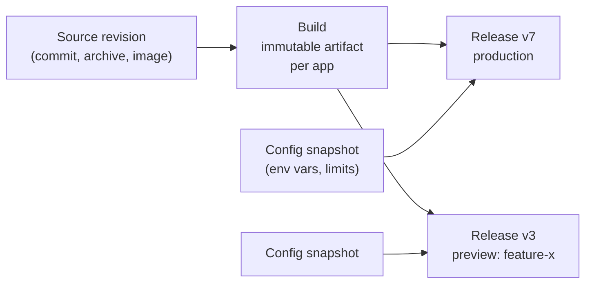
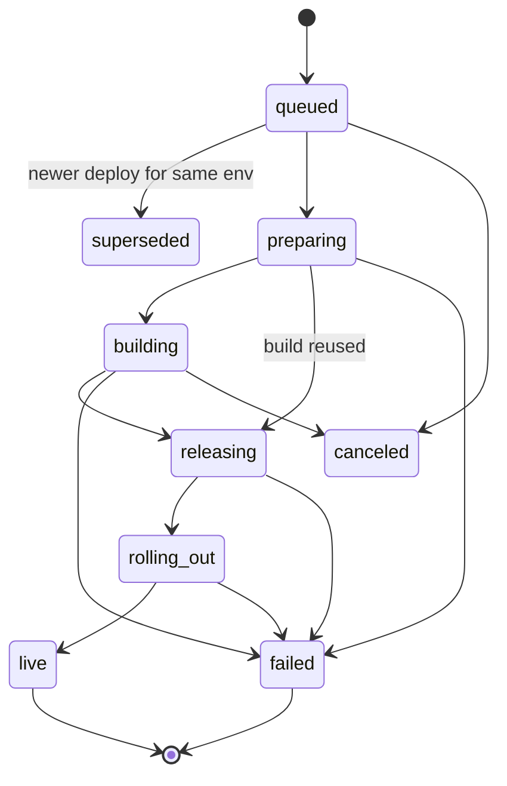
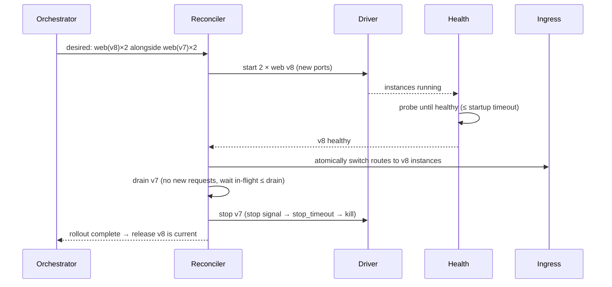

# 4. Build and Deploy

This document covers how source code gets into Moorage, how it is turned into
an immutable **build**, and how a build becomes a **release** that serves
traffic without downtime.

## Concepts



- A **build** is the output of building one source revision: a directory
  (native runtimes) or an image (container runtimes). Builds belong to the
  app, are immutable, and can be shared by several environments.
- A **release** is *build + configuration* for one environment, numbered
  `v1, v2, …` per environment. Deploying code, changing an environment
  variable, rolling back and promoting all create a new release, so every
  change is auditable and reversible.
- A **deployment** is the job that produces a release: it may build (or reuse
  a build), runs the release command, and rolls the release out.

**Build reuse.** A build is keyed by *(commit tree, resolved manifest, build-
time environment)*. If an identical build already exists — typically when a
preview branch is merged into `main` without changes — it is reused and the
production deploy skips straight to the release phase.

## Deployment sources

| Source | How | Typical use |
|---|---|---|
| **Git push over SSH** | `git push moorage main` | Day-to-day developer flow |
| **Git push over HTTPS** | Same, with an API token via `moor git credential` helper | Networks that block SSH |
| **Directory upload** | `moor deploy [DIR]` (tars the directory, honouring `.gitignore` and `.moorignore`, and always leaving out `.git`, `node_modules`, `.venv` and `__pycache__`, which the build makes again) | Quick iteration, repos hosted elsewhere, no git at all |
| **Static upload** | `moor deploy --static ./site`, or drag a folder into the console (which leaves out `.git` and `.env` files, and refuses a folder whose manifest builds or runs) | Docs, reports, SPAs |
| **Artifact upload** | `moor deploy --artifact [DIR]`: an app ready to run (a compiled binary, a script for an interpreter on the host), run with the manifest's `[processes]` | Binaries built in CI |
| **Image** | `moor deploy --image registry/app:tag` | Images built in CI |
| **Remote repository** | Connect a repository URL; deploy on webhook (GitHub, GitLab, Gitea, generic HMAC) or by polling | Code hosted on a forge, PR previews with status checks |
| **API** | `POST /api/v1/apps/{app}/envs/{env}/deployments` | Anything else |

All sources converge on the same pipeline.

## Connected repositories

A connection (`forge_connections`, one per app) holds a repository's address and, sealed with the master key and bound
to the app, a webhook secret and an optional token. It uses the push path rather than a second one:

1. A webhook arrives at `POST /api/v1/hooks/{hook}`, by a random address that survives a rename, with no account. It is
   looked up, its body read up to 25 MB, and its signature checked over those bytes, as each kind of forge signs them. The
   answer is 202: the rest happens afterwards, one thing at a time for each app.
2. What it names is fetched into `refs/moorage/forge/`, over a client that this server may reach things with on someone's
   say. **What deploys is what the fetch found, and never a commit named by an event**, so that a replayed event can do no
   more than have the server look again.
3. `gitserver.Repos.PushFor` makes a `Push` of that commit, and `deploy.Pushes.Deliver` does what it does with any push: it
   decides where it goes, honours `[skip deploy]`, `[app].watch` and locks, and follows the deployment. The branch moves when
   that has worked.

A pull request is the pseudo-branch `pr-N`, so that previews, their names, limits and their end are those of any branch.
Its `Push` has `Preview = PreviewOnly`, under which its manifest cannot send it anywhere but its own preview: a named
environment that claims `pr-N`, in a manifest or in the database, is refused. Under a connection that hears of pull requests
a branch has `PreviewNever`, or both it and its pull request would be built. A real branch called `pr-N` is left alone.

### Who may have code built

Trust is the forge's word on who may push. A pull request from the repository itself, by someone the forge vouches for, is
built. Anything else is `waiting`: it is not fetched, and it has a check and a comment that say so. A forge that does not say
where a pull request came from has it counted as a fork. A maintainer's approval (`canManage`, in the audit log) records one
commit, and after fetching, a head that is not that commit goes back to waiting without being built. The approval is of what
someone could see, and a push at the wrong moment must not get in behind it.

A check that stays pending can hold a merge up for ever, so at start the server marks what it was part of the way through
building as failed, and says so on the forge. The server's other limits on a connection: a token is dropped if the address that
it was given for changes, as whoever may change the address should not be able to have it sent elsewhere; and it is refused
over plain HTTP, unless to something on the local network.

### Polling

A connection that polls fetches `+refs/heads/*` every minute, and compares the refs under `refs/moorage/forge/heads/` before
and after. These refs persist, which gives a restart nothing to re-deploy, and no retry loop: a commit that failed is not tried
again until it changes, or someone asks. The first look deploys only the default branch.

## Git server

### Remotes

```bash
moor apps create acme-portal          # prints both remote URLs
moor git remote                       # adds a "moorage" remote in the current repo
git push moorage main
```

- SSH: `ssh://git@<console-host>:2222/<app>.git`
- HTTPS: `https://<console-host>/git/<app>.git`

**Push to create.** Pushing to an app that does not exist yet creates it (in
the user's default project), as long as the user may create apps and the
server setting allows it. The app name is taken from the remote URL, so
`git remote add moorage ssh://git@…:2222/new-thing.git && git push moorage
main` is a complete onboarding.

The git server is built in: repositories are bare repositories stored under
`<data>/repos`, and the receive side of the git protocol is implemented in
process. **No system `git` binary is required on the server.** (Building a
revision checks it out with the same library.)

### Authentication and authorisation

- **SSH:** public keys registered per user (`moor keys add ~/.ssh/id_ed25519.pub`
  or in the console). The SSH server accepts only `git-receive-pack` and
  `git-upload-pack` for known apps — no shell, no forwarding. Authorisation
  uses the key that was actually *verified* for the session, never a key the
  client merely offered (a classic SSH-server pitfall).
- **HTTPS:** HTTP Basic auth with an API token as the password.
  `moor git credential` is a git credential helper that supplies the token of
  the logged-in CLI context automatically.
- Pushing requires the **deployer** role on the app; fetching requires
  **viewer**.

### Branch → environment mapping

| Pushed ref | Result |
|---|---|
| The app's production branch (default: `main`) | Deploy to `production` |
| A branch named in `[environments.<name>].branch` | Deploy to that environment |
| Any other branch, previews enabled and branch matches `previews.branches` | Create/update the branch's **preview** |
| Any other branch, previews disabled | Push accepted, no deploy; the client is told why |
| `git push moorage --delete <branch>` | Preview for that branch is destroyed |
| Tags | Stored, not deployed (deploy a tag explicitly with `moor deploy --ref v1.2.0`) |

Force pushes are allowed — Moorage is a deploy target, not the source of
truth. Repository hooks are never executed.

### Skipping and filtering

- A commit message containing `[skip deploy]` is stored but not deployed.
- `[app].watch` globs restrict deploys to pushes that touch relevant paths
  (monorepos).
- A **deploy lock** on an environment (`moor lock`, or offered on the page of
  a rollback) stops deployments to it until `moor unlock`, so that a rollback
  is not silently overwritten by the next push. A push to it is kept, not
  built, and says so; the next deploy or `moor redeploy` after unlocking takes
  it from there. Rollbacks and changes of variables go on working.

### Push options

`git push -o <option>` adjusts a single push:

| Option | Effect |
|---|---|
| `skip-deploy` | Store the commit without deploying. |
| `env=<name>` | Deploy to an environment that exists, regardless of branch mapping. |
| `no-cache` | Build without build caches. |
| `detach` | Return as soon as the deployment is queued. |

### Live output

The push stays open while the deployment runs and streams progress back as
git progress messages, so the developer sees the whole deploy in their
terminal. `Ctrl-C` detaches; the deployment continues and can be followed
with `moor deployments follow`.

**A failed deployment fails the push.** The deployment runs *before* the ref
update is accepted (in the receive-pack pre-receive step). If it fails, the
ref update is rejected with the deployment ID, so `git push` exits non-zero
and scripts can rely on its exit status; the server-side branch stays where
it was. The pushed objects are kept, so `moor deployments retry` can run the
same commit again. With `-o detach` the ref is accepted immediately and the
deployment runs asynchronously.

```text
$ git push moorage feature/new-pricing
…
remote: moorage  acme-portal · preview "feature-new-pricing" · dep_01JBXK3…
remote: ▸ detected   python (uv) + node 24
remote: ▸ toolchains python 3.13.9, uv 0.13.7, node 24.11.1 (cached)
remote: ▸ build      uv sync --locked --no-dev
remote:              Installed 41 packages in 310ms
remote: ▸ build      npm --prefix frontend ci && npm --prefix frontend run build
remote:              ✓ built in 4.12s
remote: ▸ release    v1: alembic upgrade head … ok (1.2s)
remote: ▸ rollout    web ×1 healthy (0.9s) · worker ×1 started
remote: ✔ live       https://acme-portal--feature-new-pricing.apps.example.com  (28s)
To ssh://git.apps.example.com:2222/acme-portal.git
 * [new branch]      feature/new-pricing -> feature/new-pricing
```

### Limits

- Maximum pack size per push (default 1 GiB, configurable).
- Ref updates are serialised per repository (the git library has no
  multi-ref transactions); builds and deployments run outside that lock, so
  pushes to different branches of one app still proceed in parallel.
  `git push --atomic` is not supported.
- Git LFS is not supported initially; pushes that reference LFS pointers get
  a clear warning.
- Submodules are checked out when their URLs are reachable with credentials
  configured on the server (Phase 3).

## Pipeline



### 1. Queue

Deployments are persisted jobs. One deployment per environment runs at a
time; a newer deployment for the same environment **supersedes** any still-
queued one (the latest push wins). Builds across the server share a
concurrency limit (default: half the CPU count). Jobs interrupted by a daemon
restart are marked `failed (interrupted)` and can be retried with one click.

### 2. Prepare

1. Allocate the build directory `<data>/builds/<app>/<build-id>/`.
2. Check out the commit (or extract the archive) **directly into that
   directory**. Archive extraction rejects absolute paths, `..` traversal and
   links pointing outside the directory, and enforces size and file-count
   limits.
3. Read `moorage.toml`, run detection, apply presets and environment
   overrides, and produce the **resolved plan** (what `moor manifest explain`
   prints). The plan is stored with the build.
4. Compute the build key; if a matching build exists, skip to *Release*.

> **Why build in place?** Python virtual environments and some Node packages
> embed absolute paths. Building in the final, immutable location means the
> artifact never moves, and rollback is just a pointer change.

### 3. Toolchains

The plan lists the toolchains it needs (`python@3.13.9`, `uv@0.13.7`,
`node@24.11.1`). Missing ones are downloaded, verified and installed by the
toolchain manager (see below) under a per-toolchain lock, so concurrent
builds never race on an install.

### 4. Build

`build.pre`, the preset build (or `build.command`) and `build.post` run in the
build directory with:

- `PATH` = toolchains + project-local tool dirs (`.venv/bin`,
  `node_modules/.bin`, `$MOORAGE_BIN`) + system `PATH`;
- shared, content-addressed caches (`GOMODCACHE`, `GOCACHE`, `UV_CACHE_DIR`,
  npm/pnpm/yarn/bun caches) under `<data>/cache`;
- variables: `CI=true`, `MOORAGE_APP`, `MOORAGE_ENV`, `MOORAGE_BRANCH`,
  `MOORAGE_COMMIT`, `MOORAGE_BUILD_ID`, `MOORAGE_BUILD_DIR`, `MOORAGE_BIN`,
  the manifest's `[env]` and `[build.env]`, and server-side variables flagged
  **available at build time** (runtime secrets are *not* exposed to builds
  unless flagged);
- the build sandbox: on Linux a dedicated build user, a cgroup with memory/CPU
  limits and the `build.timeout`; elsewhere the timeout and process-group
  cleanup.
- **lower priority than running apps:** builds get a reduced CPU weight (and
  `nice`/I/O priority where available), so a heavy build slows itself down
  rather than the apps people are using.

Output is streamed to the build log file and to every subscriber (git push,
CLI, console) as it is produced.

**Container runtimes** run `podman build` / `docker build` instead, tagging
`localhost/moorage/<app>:<build-id>` with Moorage labels, and record that tag as
the build artifact (the `image` runtime pulls instead, and records the image's
digest). The source is removed once the image is built. The engine's layer cache
provides incremental builds.

### 5. Package

- Remove `.git`, paths matched by `build.exclude` and `.moorignore`.
- Record size and a content hash; make the directory read-only.
- Store the resolved toolchain versions, plan, and build log reference.

### 6. Release command

First, declared variables are checked: a missing `required` variable fails the
deployment here with a message naming it, and `generate`d variables are
created for new environments.

If `[release].command` is set, it runs **once** as a one-off instance of the
new release with the target environment's runtime configuration. Its output
goes to the deployment log. A non-zero exit or timeout fails the deployment;
the previous release keeps serving untouched. For a brand-new environment,
`[release].on_create` runs once after its first successful rollout (seed
data for previews and sandboxes).

### 7. Rollout

The rollout is executed by the reconciler as a series of desired states, so
it survives a daemon restart midway.



- **Non-web processes** (workers) are started on the new release, then the
  old ones are stopped, so there is a short overlap. Use
  `strategy = "recreate"` if overlap is unsafe.
- **Failure:** if any new instance fails to become healthy within
  `health.startup`, or exits, the new instances are stopped, routes are never
  switched, the deployment is marked failed, and the last lines of the failing
  instance's output are attached to the deployment record and shown in the
  push output/console.
- **`recreate` strategy:** old instances are drained and stopped first; while
  the new ones start, the ingress shows a "deploying" page (or holds requests
  for a few seconds, see [Ingress](06-ingress.md#platform-pages)).
- **Static apps** need no rollout: the route's document root is switched
  atomically to the new build.

### 8. Finish

The environment's current release is updated, the activity timeline and
notifications are emitted, and garbage collection is scheduled.

## Rollback, redeploy, promote, restart

| Action | What happens | Speed |
|---|---|---|
| `moor rollback [vN]` | New release pointing at an earlier build, with the **current** configuration (`--with-config` restores that release's configuration too). The release command does not run again. | Seconds — no build |
| `moor redeploy [--no-cache]` | Build the current release's source again (the same commit, upload or image name: e.g. after a toolchain update) and roll out. An upload is kept for this, as `source.tar.gz` beside its build; a build uploaded ready to run has nothing to rebuild. `--no-cache` comes with a build cache. | Build time |
| `moor promote --from <env> --to <env>` | Release the exact build running in one environment (e.g. `staging`) to another (e.g. `production`). Warns if build-time variables differ. | Seconds |
| `moor restart [process]` | Rolling restart of the current release. | Seconds |
| `moor env set A=1 B=2` | New release with the same build and new configuration, rolled out; the release command does not run again. `--no-restart` stages the change for the next deploy. | Seconds |

Rollback is unavailable only if the target build has been garbage-collected;
the console greys out such releases.

## Toolchain manager

Toolchains are downloaded on demand, **always verified**, and installed into
`<data>/toolchains/<name>/<version>` with an atomic rename. Partial versions
(`node@24`, `python@3.13`) are resolved to the newest matching release at
build time and the exact version is recorded in the build.

| Toolchain | Source | Verification |
|---|---|---|
| Go | Official download index (JSON, full release history) | SHA-256 from the index |
| Node.js | Official distribution index | `SHASUMS256.txt`, and its signature, against the project's published release keys, which come with moor |
| uv | Official release assets | Per-asset SHA-256. Its attestations are not checked: that takes a Sigstore client, which would outweigh the rest of this table |
| Python | Installed by uv (`uv python install`) into the toolchain directory | Checksums bundled with uv |
| Bun | Official release assets | `SHASUMS256.txt` |
| Deno | Official release assets | Per-asset SHA-256 file |
| Java, Rust, Ruby, PHP… | Added over time | — |

- uv runs with `UV_PYTHON_INSTALL_DIR` pointing into the toolchain store and
  with its options for linking executables into user `bin` directories and
  registering with the Windows registry switched off, so Python installs
  never leak outside Moorage's data directory.
- Caches live on the same filesystem as builds so package managers can
  hard-link files instead of copying them.
- Pruning never removes a version referenced by a retained build: a Python
  virtual environment points at the interpreter it was created with.

- `toolchains = ["java@system"]` uses whatever is on the host `PATH` instead.
- Mirrors: each provider's base URL is configurable (`[toolchains]` in
  `server.toml`) for proxies and air-gapped installs; `moor toolchains
  import <archive>` side-loads a toolchain.
- When a provider cannot be reached, a build uses the newest installed
  version that matches its request, and says so in its log.
- `moor toolchains list | install | prune` manages the cache; unused versions
  are pruned after 30 days.

## Preview environments

Previews are what make Moorage useful for showing work in progress.

- **Creation:** first push of a matching branch, `moor previews create
  <branch>`, or a pull/merge request webhook from a connected forge, which also
  gets a status check and a comment with the URL (see "Connected repositories").
- **Naming:** the environment name is a slug of the branch
  (`feature/new-pricing` → `feature-new-pricing`; max 40 characters, with a
  short hash suffix on truncation or collision). The name `preview` is
  reserved, for `[environments.preview]`.
- **URL:** `https://<app>--<env>.<base-domain>`. The double dash keeps the
  hostname a **single DNS label**, so one wildcard DNS record and one wildcard
  certificate (`*.<base-domain>`) cover every preview of every app.
- **Configuration:** inherits production's variables except those marked
  *production-only*, then applies `[environments.preview]`, then
  preview-scoped server variables, then per-preview overrides.
- **Data:** its own data directory, empty by default, or a copy of
  production's (`previews.data = "copy"`, subject to a size limit).
- **Lifecycle:** sleeps when idle (`sleep_after`), is destroyed when the branch
  is deleted or when its TTL passes without deploys or requests, and can be
  **pinned** to never expire. A per-app limit (default 10 active previews)
  prevents runaway branches.
- **Access:** gated by the server-wide preview default (e.g. *sign-in
  required*), overridable per app or per preview; share links make it easy to
  hand one to a customer.

## Retention and garbage collection

- **Builds:** kept while referenced by any of the last `keep_releases`
  releases of any environment; others are deleted (images removed through the
  engine). The current and previous release are never collected.
- **Failed build directories:** kept 24 hours for inspection
  (`moor builds inspect <id>` opens a shell there), then removed.
- **Repositories:** periodic repack; repositories of deleted apps are kept 7
  days, then removed.
- **Disk guard:** a build refuses to start below a free-space threshold
  (default 2 GiB) with a clear message, and the console shows a banner when
  the data volume is over 90 % full.
