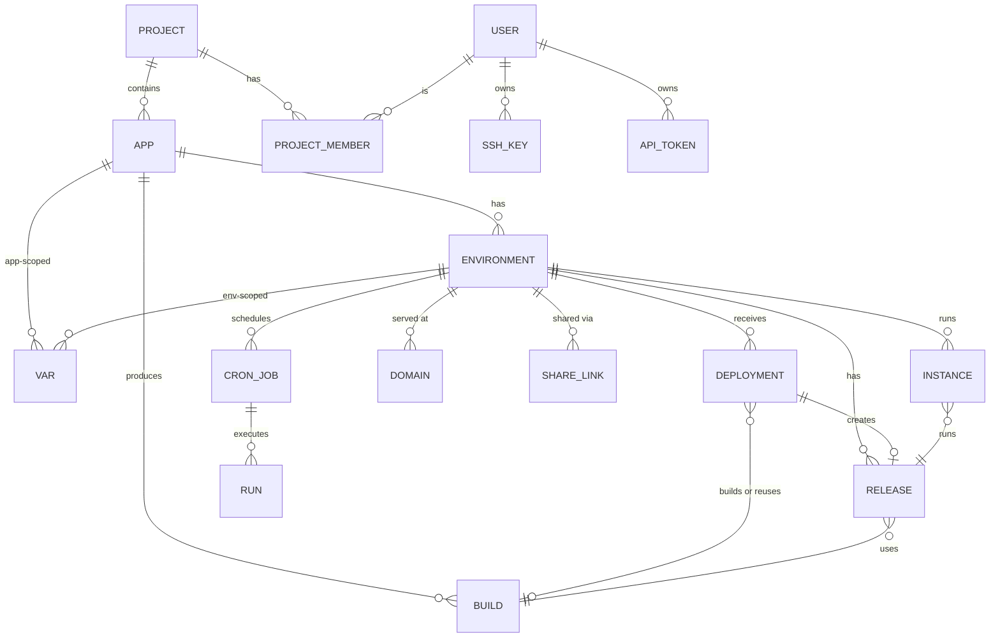

# 10. Data Model and Storage

Moorage stores **metadata and configuration in SQLite** and **bulk data in
files** (repositories, builds, logs, app data). This keeps the database small,
fast and easy to back up, and keeps bulk data inspectable with ordinary tools.

## SQLite configuration

- Driver: `modernc.org/sqlite` (pure Go), pinned together with the exact
  `modernc.org/libc` version it requires. Full-text search (FTS5) is built in
  and available for searching events and audit records.
- Pragmas: `journal_mode=WAL`, `synchronous=NORMAL`, `foreign_keys=ON`,
  `busy_timeout=5000`, `temp_store=MEMORY`; periodic `wal_checkpoint` and
  `optimize`.
- `STRICT` tables. Timestamps are `INTEGER` Unix milliseconds (UTC). Flexible
  documents (resolved manifests, settings, event payloads) are `TEXT` JSON.
- One writer connection (all writes serialised through it, short
  transactions) plus a pool of read connections.
- Queries are written in SQL and compiled to typed Go with a code generator;
  no ORM.
- **Migrations** are embedded, numbered, forward-only SQL files applied at
  startup in a transaction. Before applying migrations after an upgrade,
  Moorage writes a snapshot with `VACUUM INTO` so a failed upgrade can be
  rolled back.

## Identifiers

Every entity has a typed, sortable ID: a short prefix plus a ULID, e.g.
`app_01JBXK3M8Q…`, `env_…`, `dep_…`, `bld_…`, `rel_…`, `ins_…`, `usr_…`,
`tok_…`. Prefixes make IDs self-describing in logs, URLs and support requests.
Human-facing names (app names, environment names, release numbers) are unique
within their parent and accepted by the API wherever an ID is.

## Core entities

## Tables

### Identity and access

| Table | Key columns |
|---|---|
| `users` | `id`, `email` (unique), `name`, `password_hash` (empty until an invitation is accepted), `role` (`admin`/`member`), `totp_secret_enc`, `disabled_at`, `created_at` |
| `sessions` | `id`, `id_hash`, `user_id`, `created_at`, `last_seen_at`, `expires_at`, `ip`, `user_agent` |
| `api_tokens` | `id`, `user_id` (empty: the server's local administrator), `name` (unique per owner), `token_hash`, `scopes`, `app_id` (optional restriction), `expires_at`, `last_used_at` |
| `device_codes` | `code_hash`, `user_code`, `client`, `ip`, `approved_by`, `denied`, `last_poll_at`, `expires_at` (CLI browser login) |
| `invitations` | `code_hash`, `user_id`, `created_by`, `expires_at` (one-time links to choose a password) |
| `ssh_keys` | `id`, `user_id` (empty: the server's local administrator), `name` (unique per owner), `fingerprint` (unique), `public_key`, `last_used_at` |
| `projects` | `id`, `name`, `everyone_role` (of those who are not members), `viewers_see_logs`, `created_at` |
| `project_members` | `project_id`, `user_id`, `role` (`viewer`/`deployer`/`maintainer`) |

### Apps and environments

| Table | Key columns |
|---|---|
| `apps` | `id`, `project_id`, `name` (unique), `production_branch`, `root`, `settings` (JSON), `created_at`, `deleted_at` |
| `environments` | `id`, `app_id`, `name`, `kind` (`production`/`named`/`preview`), `branch`, `current_release_id`, `status`, `formation` (JSON: process → count), `limits` (JSON), `isolation`, `sleep_after`, `sleeping_since`, `last_request_at`, `ttl`, `pinned`, `locked` (deploy lock), `gate` (JSON), `expires_at`, `created_at` |
| `vars` | `id`, `app_id`, `env_id` (NULL = all environments), `name`, `value` or `value_enc`, `secret`, `build`, `production_only`, `updated_by`, `updated_at` |
| `domains` | `id`, `env_id`, `hostname` (unique), `path_prefix`, `kind` (`generated`/`custom`), `verified_at`, `tls_mode`, `cert_status`, `cert_expires_at` |
| `share_links` | `id`, `env_id`, `token_hash`, `created_by`, `expires_at`, `max_uses`, `uses`, `revoked_at` |

### Builds, releases, deployments

| Table | Key columns |
|---|---|
| `builds` | `id`, `app_id`, `build_key` (unique per app), `commit_sha`, `source_type`, `artifact_kind` (`dir`/`image`), `artifact_ref` (path or image digest), `plan` (JSON resolved manifest), `toolchains` (JSON), `size_bytes`, `status`, `created_at`, `gc_at` |
| `releases` | `id`, `env_id`, `version` (unique per env), `build_id`, `config_snapshot` (JSON, secret values referenced not copied), `config_hash`, `reason` (`deploy`/`config`/`rollback`/`promote`/`restart`), `created_by`, `created_at` |
| `deployments` | `id`, `env_id`, `source_type`, `source_ref`, `commit_sha`, `commit_message`, `commit_author`, `branch`, `trigger` (`push`/`cli`/`api`/`webhook`/`ui`), `triggered_by`, `status`, `stage`, `build_id`, `release_id`, `error`, `log_path`, `queued_at`, `started_at`, `finished_at` |
| `jobs` | Persistent work queue: `id`, `kind`, `payload` (JSON), `status`, `attempts`, `run_after`, `locked_until` |

### Runtime

| Table | Key columns |
|---|---|
| `instances` | `id`, `env_id`, `release_id`, `process`, `index`, `driver`, `driver_ref` (shim socket or container ID), `port`, `status`, `health`, `config_hash`, `restarts`, `last_exit` (JSON), `started_at`, `stopped_at` |
| `cron_jobs` | `id`, `env_id`, `name`, `schedule`, `timezone`, `command`, `timeout`, `overlap`, `next_run_at`, `enabled` |
| `runs` | `id`, `env_id`, `kind` (`cron`/`oneoff`/`release`), `cron_job_id`, `release_id`, `command`, `status`, `exit_code`, `log_path`, `started_by`, `started_at`, `finished_at` |
| `toolchains` | `name`, `version`, `os_arch`, `path`, `sha256`, `source_url`, `installed_at`, `last_used_at` |

Port reservations are the `port` column of live `instances` with a partial
unique index (`WHERE stopped_at IS NULL`), so two live instances can never
share a port.

### Observability

| Table | Key columns |
|---|---|
| `events` | `id`, `at`, `type`, `app`, `env` (by name: an event outlives what it is about), `actor`, `data` (JSON) — 90-day retention |
| `audit_log` | `id`, `at`, `actor`, `ip`, `action`, `target`, `result`, `data` — 1-year retention |
| `metric_series` | `id`, `name`, `labels` (JSON: app, env, process, instance, route), `kind` (`gauge`/`counter`/`histogram`) |
| `metric_1m` | `series_id`, `hour` (start), `data` (BLOB: 60 packed points of min/avg/max/last or histogram buckets) — primary key `(series_id, hour)` |
| `metric_1h` | `series_id`, `day`, `data` (BLOB: 24 packed points) |
| `notification_channels` | `id`, `kind`, `config_enc`, `created_by` |
| `notification_rules` | `id`, `scope` (server/project/app), `scope_id`, `event_types`, `channel_id` |
| `notifications` | In-console notifications: `id`, `user_id`, `event_id`, `read_at` |

### Settings

| Table | Key columns |
|---|---|
| `settings` | `key`, `value` (JSON), `updated_by`, `updated_at` — runtime server settings |
| `schema_migrations` | `version`, `applied_at` |

## Files

| Data | Location | Notes |
|---|---|---|
| Git repositories | `repos/<app>.git` | Bare; periodic repack |
| Builds | `builds/<app>/<build-id>/` | Read-only after packaging; deleted by GC. An upload's `source.tar.gz` is kept beside it, for a redeploy |
| App data | `data/<app>/<env>/` | Owned by the app's UID under `user` isolation |
| App logs | `logs/apps/<app>/<env>/<process>.<index>.<instance>.log[.N]` | Written and rotated by the shim |
| Build and run logs | `logs/builds/<deployment>.log`, `logs/runs/<run>.log` | |
| Access logs | `logs/router/<app>/<env>.log[.N]` | |
| Certificates | `certs/` | ACME account, certificates, internal CA material |
| Keys | `keys/` | Master key, SSH host keys (`0700` directory) |

## Sizing

For a server with ~100 environments over a year, the database stays well under
1 GB: metric roll-ups dominate (≈ 24 rows per series per day for the 1-minute
tier, kept 14 days; ≈ 1 row per series per day for the hourly tier), followed
by events. Logs and builds — the large data — are files with their own
retention.
